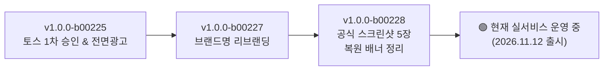
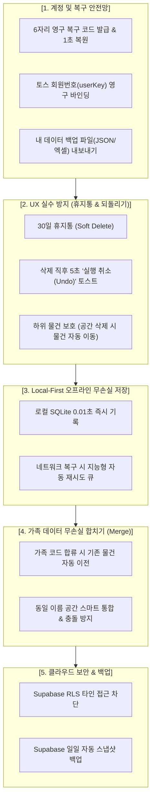
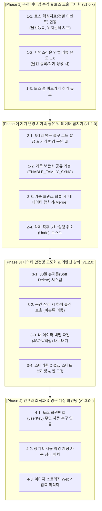

# 🗺️ '아 찾았다 · 내 물건 찾기' 마스터 종합 개발 로드맵
> **부제**: 토스 추천 미니앱 승격 전략 및 유저 데이터 100% 안전성 보장 통합 플랜

---

## 📌 1. 현재까지의 개발 및 출시 현황 (As-Is)

현재 **`아 찾았다 · 내 물건 찾기`**는 토스 실서비스(Live)에 정상 배포되어 활발히 운영 중입니다.

### 1.1 주요 달성 성과
- **정식 출시 및 광고 수익화**: 토스 앱 내 정식 런칭 및 라이브 전면 광고(`ait.v2.live.41b1a3be69b94e33`) 정상 송출.
- **공식 브랜드명 확립**: 스토어 중복 명칭 이슈를 해결하고 직관적인 `아 찾았다 · 내 물건 찾기`로 개편.
- **스토어 ASO(검색 최적화) 기반 마련**: 토스 권장 규격(**636 × 1048**)에 맞춘 고화질 실기기 스크린샷 5장 등록 완료.
- **고속 듀얼 데이터 아키텍처**: SQLite(로컬 0.01초 오프라인 DB) + Supabase(실시간 클라우드 동기화).

---

## 💡 2. 당면 핵심 과제 및 데이터 위협 요인 분석

| 영역 | 위험 시나리오 / 사용자 고민 | 해결 방안 |
| :--- | :--- | :--- |
| **토스 노출 극대화** | 단순 검색창 노출에 머물러 신규 유저 유입이 제한됨 | 토스 메인 큐레이션 구좌인 **'추천 미니앱'** 진입을 위한 **핵심지표(전환 이벤트)** 및 **인앱 리뷰 유도 UX** 구축 |
| **기기 변경 / 분실** | 새 스마트폰으로 교체하거나 공장초기화 시 데이터 유실 | **6자리 영구 복구 코드** 발급 및 장기적 **토스 회원번호(`userKey`) 연동** |
| **앱 캐시 / 세션 삭제** | 브라우저 캐시 삭제나 앱 재설치 시 익명 세션 유실 | 복구 코드 1초 복원 및 로컬 SQLite 데이터 보존 |
| **가족 데이터 통합** | 남편과 아내가 각자 쓰다가 합칠 때 한쪽 데이터가 삭제됨 | 가족 보관소 합류 시 **'기존 내 데이터 함께 가져가기(Merge)'** 지원 |
| **실수로 인한 삭제** | 공간이나 물건을 실수로 잘못 삭제했을 때 복구 불가 | **30일 휴지통(Soft Delete)** 및 **5초 실행 취소(Undo) 토스트** |
| **오프라인 환경** | 지하 창고나 통신 불통 지역에서 물건 등록 시 저장 실패 | **Local-First(SQLite 선반영)** + 백그라운드 지능형 동기화 큐 |
| **리텐션(재방문율)** | 물건을 등록한 뒤 다시 앱을 열어볼 동기 부족 | **소비기한 임박 D-Day 스마트 브리핑** 및 자주 찾는 물건 핀 고정 |

---

## 🛡️ 3. 유저 데이터 100% 안전 보장을 위한 5대 핵심 안전망

---

## 🚀 4. 통합 단계별 개발 로드맵 (To-Be)

---

### 📍 Phase 1: 추천 미니앱 승격 & 토스 노출 극대화 (버전: v1.0.1 ~ v1.0.2)
> **목표**: 토스 검색창 검색에만 의존하지 않고, 토스 앱의 **'추천 미니앱 큐레이션'** 및 **'전체/혜택 탭'**에 노출되어 자연 유입을 극대화합니다.

1. **토스 핵심지표(Conversion Event) 연동 (P0, 최우선)**
   - 토스 콘솔에 핵심 성과 이벤트 등록:
     - `item_created` (물건 등록 완료 - 핵심 가치 생성)
     - `item_searched` (물건 찾기 성공 - 핵심 가치 소비)
     - `expiry_checked` (소비기한 확인 - 리텐션)
   - 앱 내에서 액션 완료 시 토스 Analytics SDK로 이벤트 발송.
2. **기분 좋은 타이밍의 인앱 리뷰 유도 UX**
   - 물건을 3개 이상 등록했거나, 검색으로 원하는 물건의 위치를 확인했을 때 친근한 토스 리뷰 바텀시트 호출.
   - 높은 평점과 활성 리뷰를 축적하여 토스 스토어 랭킹 상승.
3. **토스 홈 화면 '바로가기 추가' 유도**
   - 홈 탭 또는 설정에서 토스 앱 바탕화면에 미니앱 아이콘을 바로가기로 추가할 수 있도록 지원.

---

### 📍 Phase 2: 기기 변경 지원 & 가족 공유 및 데이터 무손실 합치기 (버전: v1.1.0)
> **목표**: 폰을 바꾸거나 앱 캐시를 지워도 데이터 유실 걱정이 없고, 가족이 각자 쓰던 데이터를 하나로 깔끔하게 합쳐서 쓸 수 있도록 지원합니다.

1. **6자리 영구 복구 코드(Recovery Code) 시스템**
   - 설정(더보기) 탭에서 내 보관소의 고유 복구 코드(예: `MY-8291`) 확인 및 복사 기능.
   - 새 기기에서 첫 실행 시 **"이전 보관소 불러오기"**에 코드 입력 시 기존 데이터 즉시 동기화.
2. **가족/동거인과 함께 쓰는 공유 보관소 (`ENABLE_FAMILY_SYNC`)**
   - 동일한 코드로 접속한 가족들이 같은 집의 냉장고, 창고 물건을 실시간으로 함께 관리.
3. **🔥 가족 보관소 합류 시 '기존 내 데이터 합치기(Merge)' 기능**
   - 남편이 아내의 가족 코드로 합류할 때 기존에 등록해 둔 남편의 물건들이 삭제되지 않도록 보호.
   - 코드 입력 시 모달: `"기존에 등록한 내 공간과 물건(OO개)을 가족 보관소로 함께 가져갈까요?"`
   - `[예, 함께 합치기]` 선택 시: 소유 ID를 가족 보관소로 일괄 자동 전환하여 무손실 병합.
4. **삭제 직후 5초 '실행 취소(Undo)' 토스트**
   - 물건이나 공간 삭제 시 화면 하단에 5초간 실행 취소 버튼을 노출하여 실수 즉시 복원.

---

### 📍 Phase 3: 데이터 안전망 고도화 & 리텐션 강화 (버전: v1.2.0)
> **목표**: 휴지통 시스템으로 실수 삭제를 완벽히 방지하고, 소비기한 알림으로 지속적인 재방문을 만듭니다.

1. **30일 휴지통(Soft Delete) 시스템**
   - 삭제된 항목은 DB에서 영구 삭제되지 않고 `deleted_at` 처리되어 30일간 보관.
   - 설정 내 **[휴지통]** 메뉴에서 원클릭으로 완벽 복원.
2. **공간 삭제 시 하위 물건 보호**
   - 물건이 들어있는 공간/수납처 삭제 시 물건이 함께 증발하지 않고 **[미분류 보관함]**으로 자동 안전 이동.
3. **내 데이터 백업 파일(JSON/엑셀) 내보내기/가져오기**
   - 유저가 원할 때 언제든 내 물건 전체 목록을 파일로 다운로드하여 개인 소장 가능.
4. **소비기한 D-Day 스마트 브리핑 & 핀 고정**
   - 유통기한 3일/7일 남은 물건 홈 상단 브리핑.
   - 자주 찾는 물건(손톱깎이, 여권 등) 홈 상단 즐겨찾기 고정.

---

### 📍 Phase 4: 인프라 최적화 & 영구 계정 바인딩 (버전: v1.3.0 ~ 지속)
> **목표**: 토스 로그인 연동으로 복구 코드조차 필요 없는 무인 자동 복구를 실현하고, DB 비용과 성능을 최적화합니다.

1. **토스 회원번호(`userKey`) 기반 100% 무인 자동 복구 연동**
   - 토스 계정과 보관소를 1:1로 영구 바인딩하여, 폰을 바꾸든 앱을 재설치하든 별도 입력 없이 자동 복구.
2. **미사용 익명 계정(Orphan Data) 수명 주기 관리**
   - 90일 이상 동기화가 없는 빈 익명 계정 자동 정리 배치.
3. **이미지 리사이징 & WebP 최적화**
   - 업로드 사진을 300KB 이내 WebP로 자동 압축하여 빠른 로딩 및 스토리지 절감.

---

## 📋 5. 종합 우선순위 결정 매트릭스

| 우선순위 | 작업 항목 | 예상 공수 | 기대 효과 |
| :---: | :--- | :---: | :--- |
| **P0 (최우선)** | **토스 핵심지표(전환 이벤트) & 인앱 리뷰 유도** | 1~2일 | **추천 미니앱 승격**을 통한 실제 토스 유저 유입량 대폭 증가 |
| **P1 (핵심)** | **기기 변경 복구 코드 & 가족 데이터 합치기(Merge) & 5초 Undo** | 2일 | 기기 교체/초기화 시 데이터 유실 방지 및 **가족 간 데이터 완전 통합** |
| **P2 (안전/리텐션)** | **30일 휴지통(Soft Delete) & 소비기한 D-Day 브리핑** | 1~2일 | 실수 삭제 완벽 복원 및 매일/매주 재방문율(리텐션) 증가 |
| **P3 (고도화/운영)** | **토스 userKey 영구 바인딩 & Supabase 수명주기 관리** | 1일 | 무인 자동 복구 완성 및 장기 클라우드 비용/성능 최적화 |
