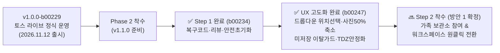
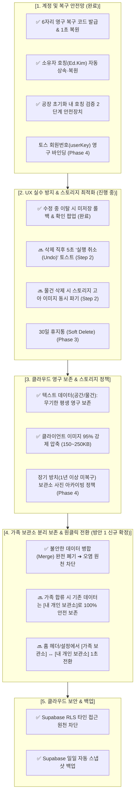
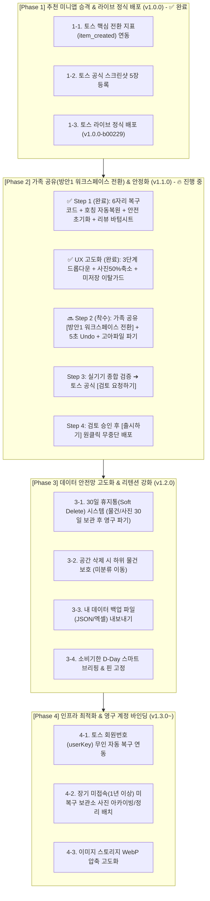

# 🗺️ '아 찾았다 · 내 물건 찾기' 마스터 종합 개발 로드맵
> **부제**: 토스 추천 미니앱 승격 전략 및 유저 데이터 100% 안전성 보장 통합 플랜  
> **최종 갱신일**: 2026-11-18 (Phase 2 - 가족 공유 '워크스페이스 전환 모델' 확정 반영)

---

## 📌 1. 현재까지의 개발 및 출시 현황 (As-Is)

현재 **`아 찾았다 · 내 물건 찾기`**는 **`v1.0.0-b00229`**가 토스 실서비스(Live)에 정상 운영 중이며, **`Phase 2 (v1.1.0)`** 개발이 활발히 진행되어 **`b00247`**까지 핵심 UX 고도화 및 안정화가 완료되었습니다.

### 1.1 주요 달성 성과
- **정식 출시 및 광고 수익화 (v1.0.0 라이브)**: 토스 앱 내 정식 런칭 및 전면 광고 정상 송출.
- **Phase 2 1단계(Step 1) 완수 (`b00230` ~ `b00234`)**:
  - 6자리 영구 복구 코드 발급 및 1초 보관소 복원 시스템 구축
  - 복원 시 기존 소유자 호칭(**`Ed.Kim`**) 자동 상속 및 동기화
  - 대화형 인앱 리뷰 바텀시트(1~5점 별점, 키워드 칩, 햅틱 피드백) 탑재
  - 공장 초기화 시 위험한 실행 경고 확인(내 호칭 검증) 2단계 안전장치 탑재
- **Phase 2 핵심 UX 고도화 완수 (`b00235` ~ `b00247`)**:
  - 공간/수납처/세부위치 3단계 계층을 한눈에 파악하는 **컴팩트 사진 드롭다운 선택기** 전면 도입
  - 물건 수정 중 미저장 이탈 시 데이터 롤백 및 안전 확인 팝업(`hasUnsavedChanges`) 일원화
  - 바텀시트 내 물건 사진 크기 50% 축소(140px 캡)로 핵심 정보(위치, 수량, 유통기한) 가독성 극대화
  - 물건 사진 변경/촬영 안내 가이드 및 `[📷 사진 변경하기]` 뱃지 추가

---

## 💡 2. 당면 핵심 과제 및 데이터 위협 요인 분석 (개편)

| 영역 | 위험 시나리오 / 사용자 고민 | [방안 1] 기반 해결 방안 및 현황 |
| :--- | :--- | :--- |
| **토스 노출 극대화** | 단순 검색창 노출에 머물러 신규 유저 유입이 제한됨 | **[완료]** 토스 추천 미니앱 승격을 위한 **핵심 전환 지표(`item_created`)** 및 **대화형 인앱 리뷰 바텀시트** 구축 |
| **기기 변경 / 분실** | 새 스마트폰 교체나 앱 재설치 시 데이터 유실 | **[완료]** **6자리 영구 복구 코드** 발급 및 1초 복원 (장기적 **토스 userKey 연동**) |
| **호칭 / 데이터 동기화** | 초기화 후 복구 시 사용자 닉네임이 '소유자'로 초기화 | **[완료]** 보관소 내 기존 소유자 호칭(**`Ed.Kim`**) 자동 상속·동기화 엔진 탑재 |
| **실수 초기화 방지** | 실수로 초기화 버튼을 눌러 데이터가 지워지는 사고 | **[완료]** **위험한 실행 경고 확인**: 내 호칭을 정확히 입력해야 확인창으로 진입하는 2단계 검증 |
| **가족 합류 시 데이터 불안** | 기존 병합(Merge) 방식의 중복 공간 생성, 롤백 불가, 메인 보관소 오염 위험 | **[방안 1 확정] '워크스페이스 전환' 모델** • 가족 합류 시 메인 보관소로 데이터 강제 병합하지 않음 • 기존 기기 데이터는 **[내 개인 보관소]**로 100% 안전 분리 보존 • **[가족 보관소] ↔ [내 개인 보관소] 원클릭 전환** 지원 |
| **사진 용량 / 고아 파일** | 물건 삭제 후에도 사진 파일이 남아 스토리지를 잠식 | **[Step 2 예정]** **물건/수납처 삭제 시 Supabase Storage 이미지 파일 동시 파기** |
| **실수로 인한 삭제** | 공간이나 물건을 실수로 잘못 삭제했을 때 복구 불가 | **[Step 2 예정]** **삭제 직후 5초 '실행 취소(Undo)' 토스트** / **[Phase 3]** **30일 휴지통** |
| **리텐션(재방문율)** | 물건을 등록한 뒤 다시 앱을 열어볼 동기 부족 | **[Phase 3]** **소비기한 임박 D-Day 스마트 브리핑** 및 자주 찾는 물건 핀 고정 |

---

## 🛡️ 3. 유저 데이터 100% 안전 보장을 위한 5대 핵심 안전망

---

## 🚀 4. 통합 단계별 개발 로드맵 (To-Be)

---

### 📍 Phase 2 상세 계획: 가족 공유 [방안 1] 워크스페이스 전환 모델 (`v1.1.0`)

> **핵심 철학**: "위험한 데이터 병합(Merge)을 배제하고, 완벽한 데이터 격리 및 원클릭 전환(Switching)으로 100% 안전성을 달성한다."

#### 1. 가족 보관소 합류 UX (`Join Family Storage`)
- 가족 구성원이 초대 코드를 입력하여 참여할 때:
  - *"초대받은 **[OO네 보관소]**에 참여합니다. 기존 기기에 있던 데이터는 **[내 개인 보관소]**로 안전하게 보존되며 언제든 전환할 수 있습니다."* 안내 모달 노출.
  - 기존 기기의 데이터를 메인 가족 보관소로 억지로 합치지 않음(Zero Collision).
  - 합류 즉시 메인 가족 보관소의 정식 멤버로 연동되어 모든 가족이 동일한 공간/물건을 함께 조회하고 실시간 관리.

#### 2. 워크스페이스 원클릭 전환 UX (`Workspace Switching`)
- **홈 탭 상단 헤더**:
  - 현재 보관소 이름 옆 드롭다운 버튼 배치 (예: `[Ed.Kim네 가족보관소 ▾]`)
  - 터치 시 토스 계좌 목록처럼 깔끔한 바텀시트 노출:
    - `🏠 Ed.Kim네 가족보관소` (현재 활성, 구성원 3명)
    - `👤 내 개인 보관소` (내 기기 전용 보관소)
  - 탭 한 번으로 1초 만에 보관소 전환 완료.
- **설정 탭**:
  - `[보관소 관리 / 전환]` 메뉴에서 현재 내가 속한 보관소 목록 확인 및 전환 지원.

#### 3. 탈퇴 및 원상 복구 안전망 (`Safe Leave & Revert`)
- 가족 보관소에서 탈퇴하거나 초대가 만료되어도, 기존 `[내 개인 보관소]` 데이터는 1바이트도 훼손되지 않고 원형 그대로 유지.
- 복잡한 데이터 분리 작업이 전혀 필요 없으므로 기술적 버그 및 데이터 유실 위험 0%.

#### 4. 동시 진행 항목
- **5초 삭제 실행 취소(Undo) 토스트**: 물건/공간 삭제 즉시 하단 실행 취소 토스트 지원.
- **스토리지 고아 이미지(Orphan File) 동시 파기**: 물건 삭제 시 연결된 Supabase Storage 이미지 실시간 삭제.
- **가족 공유 플래그 정식 활성화**: `ENABLE_FAMILY_SYNC = true`

---

## 📋 5. 종합 우선순위 결정 매트릭스 (수정본)

| 우선순위 | 작업 항목 | 진행 상태 | 기대 효과 |
| :---: | :--- | :---: | :--- |
| **P0 (최우선)** | **토스 핵심 전환 지표 & 인앱 리뷰 인프라** | **✅ 완료 (Phase 1)** | **추천 미니앱 승격**을 통한 실제 토스 유저 유입량 대폭 증가 |
| **P0 (안전)** | **6자리 복구 코드 & 소유자 호칭 복원 & 안전 초기화** | **✅ 완료 (Phase 2-Step 1)** | 기기 교체/초기화 시 데이터 100% 보존 및 실수 초기화 원천 차단 |
| **P0 (UX)** | **드롭다운 위치선택 & 사진 50% 축소 & 미저장 가드** | **✅ 완료 (Phase 2-UX)** | 한눈에 들어오는 가독성, 사진 편집 편의성 및 데이터 오입력 방지 |
| **P1 (핵심)** | **가족 보관소 [방안 1] 워크스페이스 전환 모델** | **🔜 착수 (Phase 2-Step 2)** | **불안한 Merge 폐기**, 메인 보관소 오염 원천 차단, 100% 무손실 안전 공유 |
| **P1 (최적화)** | **5초 Undo & 스토리지 고아파일 동시 파기** | **🔜 착수 (Phase 2-Step 2)** | 실수 삭제 즉시 복구 및 **스토리지 용량 누수 방지** |
| **P2 (안전/리텐션)** | **30일 휴지통(Soft Delete) & 소비기한 D-Day 브리핑** | 대기 (Phase 3) | 실수 삭제 완벽 복원 및 매일/매주 재방문율(리텐션) 증가 |
| **P3 (고도화/운영)** | **토스 userKey 영구 바인딩 & 장기 방치 사진 수명주기 관리** | 대기 (Phase 4) | 무인 자동 복구 완성 및 장기 클라우드 비용/성능 최적화 |
