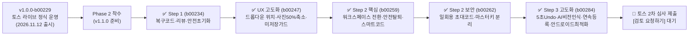
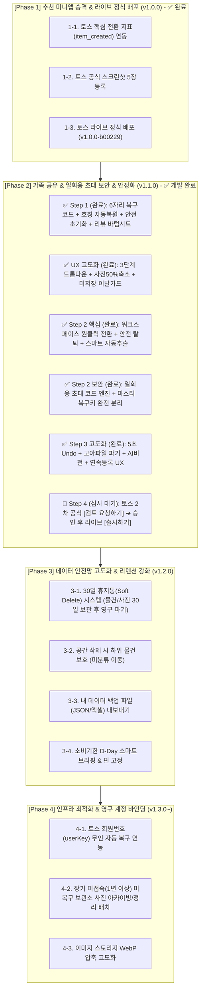

# 🗺️ '아 찾았다 · 내 물건 찾기' 마스터 종합 개발 로드맵
> **부제**: 토스 추천 미니앱 승격 전략 및 유저 데이터 100% 안전성 보장 통합 플랜  
> **최종 갱신일**: 2026-11-23 (Phase 2 - v1.1.0-b00284 기능 개발·안정화 100% 완료 및 심사 대기)

---

## 📌 1. 현재까지의 개발 및 출시 현황 (As-Is)

현재 **`아 찾았다 · 내 물건 찾기`**는 **`v1.0.0-b00229`**가 토스 실서비스(Live)에 정상 운영 중이며, **`Phase 2 (v1.1.0)`**는 **`b00230` ~ `b00284`**에 걸쳐 데이터 백업·복원, 워크스페이스 전환 모델, 일회용 초대 보안 엔진, AI Vision 스마트 인식, 연속 등록 편의성 및 안드로이드/실기기 최적화까지 **전체 목표 기능 개발 및 안정화가 100% 완료**되었습니다.

### 1.1 주요 달성 성과
- **정식 출시 및 광고 수익화 (v1.0.0 라이브)**: 토스 앱 내 정식 런칭 및 전면 광고 정상 송출.
- **Phase 2 1단계(Step 1) 완수 (`b00230` ~ `b00234`)**:
  - 6자리 영구 복구 코드 발급 및 1초 보관소 복원 시스템 구축
  - 복원 시 기존 소유자 호칭(**`Ed.Kim`**) 자동 상속 및 동기화
  - 대화형 인앱 리뷰 바텀시트(1~5점 별점, 키워드 칩, 햅틱 피드백) 탑재
  - 공장 초기화 시 위험한 실행 경고 확인(내 호칭 검증) 2단계 안전장치 탑재
- **Phase 2 핵심 UX 고도화 완수 (`b00235` ~ `b00247`)**:
  - 공간/수납처/세부위치 3단계 계층을 한눈에 파악하는 **컴팩트 사진 드롭다운 선택기** 전면 도입
  - 물건 수정 중 미저장 이탈 시 데이터 롤백 및 안전 확인 팝업(`hasUnsavedChanges`) 일원화
  - 바텀시트 내 물건 사진 크기 50% 축소(140px 캡)로 핵심 정보(위치, 수량, 유통기한) 가독성 극대화
  - 실수 삭제 즉시 복구 **5초 Undo 토스트** 및 삭제 시 스토리지 고아 이미지 파일 동시 파기 파이프라인 탑재
- **Phase 2 가족 공유 & 워크스페이스 전환 완수 (`b00248` ~ `b00259`)**:
  - 위험한 병합(Merge)을 배제하고 개인 보관소를 100% 보존하는 **워크스페이스 전환(Switching) 모델** 탑재
  - 가족 보관소 탈퇴 시 내 개인 보관소로 안전 복귀(`Safe Leave & Revert`) 검증 완료
  - 가족 공유 메시지 3줄 간소화 및 호칭 자동 주입
  - 메신저 전체 텍스트 붙여넣기 시 코드만 자동 판별하는 **스마트 코드 자동 추출(Smart Auto-Extraction)** 탑재
- **보안 아키텍처 개편 완수 (`b00260` ~ `b00262`)**:
  - **마스터 복구키(소유자 영구 보관)**와 **가족 초대 코드(1회용 소모품 티켓)** 완전 분리
  - 초대 코드는 1회 승인 시 영구 파기(Used), 24시간 TTL, 원터치 재발급
- **AI 스마트 비전 & 연속 등록 UX 완수 (`b00274` ~ `b00280`)**:
  - Google Gemini Vision 실시간 연동: 사진 업로드 시 물건 명칭 및 태그 자동 추천
  - 이전 저장 위치(공간/수납처/세부위치) 자동 기억 기능 및 저장 후 상단 부드러운 스크롤로 연속 등록 극대화
- **실기기/안드로이드 최적화 & 크래시 방지 완수 (`b00281` ~ `b00284`)**:
  - 카메라 사진 메모리 크래시 방지(Blob URL + 1024px 선제 압축)
  - 네이티브 뒤로가기 화살표(`withBackButton: true`) 복원 및 키보드 선제 블러(`activeElement.blur()`)
  - 물건 목록 내 한 줄 메모(설명) 표시 및 브레드크럼 스크롤 고정 (`sticky`)

---

## 💡 2. 당면 핵심 과제 및 데이터 위협 요인 분석

| 영역 | 위험 시나리오 / 사용자 고민 | 해결 방안 및 현황 |
| :--- | :--- | :--- |
| **토스 노출 극대화** | 단순 검색창 노출에 머물러 신규 유저 유입이 제한됨 | **[완료]** 토스 추천 미니앱 승격을 위한 **핵심 전환 지표(`item_created`)** 및 **대화형 인앱 리뷰 바텀시트** 구축 |
| **기기 변경 / 분실** | 새 스마트폰 교체나 앱 재설치 시 데이터 유실 | **[완료]** **영구 마스터 복구 코드** 발급 및 1초 복원 (장기적 **토스 userKey 연동**) |
| **초대 시 소유권 탈취 위험** | 가족 초대 시 복구 코드가 노출되어 소유권 탈취 가능성 | **[b00260 확정] 일회용 초대 코드(One-time Ticket) 분리 엔진** • 영구 복구 마스터키(나만 보관) vs 일회용 초대 코드 완전 분리 • 초대 코드는 1회 사용(승인) 시 즉시 영구 파기(Used) • 24시간 자동 만료(TTL) 및 원터치 새 초대 코드 재발급 지원 • 초대 코드로 보관소 복구(소유권 획득) 시도 시 원천 차단 |
| **가족 합류 시 데이터 오염** | 기존 병합(Merge) 방식의 중복 공간 생성, 롤백 불가, 메인 보관소 오염 위험 | **[완료] '워크스페이스 전환' 모델** • 가족 합류 시 메인 보관소로 데이터 강제 병합하지 않음 • 기존 기기 데이터는 **[내 개인 보관소]**로 100% 안전 분리 보존 • **[가족 보관소] ↔ [내 개인 보관소] 원클릭 전환** 지원 |
| **공유 코드 입력 번거로움** | 메신저에서 메시지 복사 시 긴 문장과 함께 복사되어 입력 오류 발생 | **[완료] 스마트 코드 자동 추출** • 메신저 3줄 문장 전체를 붙여넣어도 `wii-xxxxxx` 또는 6자리 코드만 스마트하게 추출 |
| **사진 용량 / 고아 파일** | 물건 삭제 후에도 사진 파일이 남아 스토리지를 잠식 | **[Step 2 예정]** **물건/수납처 삭제 시 Supabase Storage 이미지 파일 동시 파기** |
| **실수로 인한 삭제** | 공간이나 물건을 실수로 잘못 삭제했을 때 복구 불가 | **[Step 2 예정]** **삭제 직후 5초 '실행 취소(Undo)' 토스트** / **[Phase 3]** **30일 휴지통** |
| **리텐션(재방문율)** | 물건을 등록한 뒤 다시 앱을 열어볼 동기 부족 | **[Phase 3]** **소비기한 임박 D-Day 스마트 브리핑** 및 자주 찾는 물건 핀 고정 |

---

## 🛡️ 3. 유저 데이터 100% 안전 보장을 위한 5대 핵심 안전망

```mermaid
flowchart TD
    subgraph S1["[1. 계정 및 복구 안전망 (완료 및 고도화)]"]
        S1_1["✅ 영구 마스터 복구 코드 발급 & 1초 복원"]
        S1_2["✅ 소유자 호칭(Ed.Kim) 자동 상속·복원"]
        S1_3["✅ 공장 초기화 내 호칭 검증 2단계 안전장치"]
        S1_4["🔥 일회용 초대 코드(One-time Ticket) 분리 발급 & 승인 시 자동 소멸 (b00260)"]
        S1_5["토스 회원번호(userKey) 영구 바인딩 (Phase 4)"]
    end

    subgraph S2["[2. UX 실수 방지 & 스토리지 최적화 (진행 중)]"]
        S2_1["✅ 수정 중 이탈 시 미저장 롤백 & 확인 팝업 (완료)"]
        S2_2["✅ 스마트 코드 자동 추출로 오타 및 오입력 방지 (완료)"]
        S2_3["🔜 삭제 직후 5초 '실행 취소(Undo)' 토스트 (Step 2)"]
        S2_4["🔜 물건 삭제 시 스토리지 고아 이미지 동시 파기 (Step 2)"]
        S2_5["30일 휴지통 (Soft Delete) (Phase 3)"]
    end

    subgraph S3["[3. 클라우드 영구 보존 & 스토리지 정책]"]
        S3_1["✅ 텍스트 데이터(공간/물건): 무기한 평생 영구 보존"]
        S3_2["✅ 클라이언트 이미지 95% 강제 압축 (150~250KB)"]
        S3_3["장기 방치(1년 이상 미복구) 보관소 사진 아카이빙 정책 (Phase 4)"]
    end

    subgraph S4["[4. 가족 보관소 분리 보존 & 원클릭 전환 (완료)]"]
        S4_1["✅ 불안한 데이터 병합(Merge) 완전 폐기 ➔ 오염 원천 차단"]
        S4_2["✅ 가족 합류 시 기존 데이터는 [내 개인 보관소]로 100% 안전 보존"]
        S4_3["✅ 홈 헤더/설정에서 [가족 보관소] ↔ [내 개인 보관소] 1초 전환"]
        S4_4["✅ 가족 보관소 탈퇴 시 내 개인 보관소 안전 복귀"]
    end

    subgraph S5["[5. 클라우드 보안 & 백업]"]
        S5_1["✅ Supabase RLS 타인 접근 원천 차단"]
        S5_2["✅ 일회용 코드 만료 시 재사용 원천 차단"]
        S5_3["✅ Supabase 일일 자동 스냅샷 백업"]
    end

    S1 --> S2
    S2 --> S3
    S3 --> S4
    S4 --> S5
```

---

## 🚀 4. 통합 단계별 개발 로드맵 (To-Be)

---

### 📍 Phase 2 상세 계획: 일회용 초대 코드 & 워크스페이스 전환 모델 (`v1.1.0`)

#### 1. 마스터 복구키 vs 일회용 초대 코드 분리 아키텍처 (`b00260`)
- **보관소 복구 코드 (Master Recovery Key)**:
  - 기기 변경 / 앱 재설치 시 소유자 본인 인증 및 보관소 복원 전용.
  - 외부 노출 절대 금지 (나만 안전하게 보관).
  - 입력 시 즉시 소유자(Owner) 권한 복원.
- **가족 초대 코드 (One-Time Invite Ticket)**:
  - 가족에게 카카오톡 메시지로 공유하는 1회용 티켓.
  - 소유자가 원터치로 발급(`[가족 초대 코드 생성]`).
  - 참여자 입력 시 [참여 신청]만 가능하며, 복구 메뉴에 입력 시 접근 원천 차단.
  - 소유자가 [승인]하는 즉시 **해당 코드는 영구 만료(Used)** 처리되어 재사용 불가.
  - 미사용 시에도 24시간 후 자동 만료. 언제든 새 코드 원터치 재발급 가능.

#### 2. 가족 보관소 합류 및 워크스페이스 전환 UX
- **가족 합류 시 무손실 보존**:
  - 기존 기기의 데이터를 메인 가족 보관소로 억지로 합치지 않음(Zero Collision).
  - 기존 데이터는 `[내 개인 보관소]`로 100% 안전 격리 보존.
- **원클릭 전환**:
  - 홈 상단 헤더 및 설정 탭에서 `[가족 보관소] ↔ [내 개인 보관소]` 원터치 1초 전환.
- **안전 탈퇴 및 원상 복구**:
  - 가족 보관소 탈퇴 시 내 개인 보관소로 100% 원형 그대로 복귀.

---

## 📋 5. 종합 우선순위 결정 매트릭스 (최신 갱신)

| 우선순위 | 작업 항목 | 진행 상태 | 기대 효과 |
| :---: | :--- | :---: | :--- |
| **P0 (보안/안전)** | **일회용 초대 코드 엔진 & 복구키 분리** | **✅ 구현 완료 (`b00260`)** | **복구 마스터키 노출 원천 차단**, 1회 사용 후 소멸하는 완벽한 보안성 |
| **P0 (핵심)** | **가족 보관소 워크스페이스 전환 모델** | **✅ 완료 (Phase 2-Step 2)** | **불안한 Merge 폐기**, 메인 보관소 오염 원천 차단, 100% 무손실 안전 공유 |
| **P0 (UX)** | **스마트 코드 자동 추출 & 메시지 간소화** | **✅ 완료 (Phase 2-Step 2)** | 메신저 3줄 복사-붙여넣기 시 코드만 자동 추출, 사용자 오입력 0% |
| **P1 (안정성)** | **가족 보관소 안전 탈퇴 및 원상 복구** | **✅ 완료 (Phase 2-Step 2)** | 탈퇴 시 개인 보관소 100% 보존 복귀 |
| **P1 (최적화)** | **5초 Undo & 스토리지 고아파일 동시 파기** | **✅ 완료 (`b00272`)** | 실수 삭제 즉시 복구 및 **스토리지 용량 누수 방지** |
| **P1 (AI/등록)** | **Gemini AI 비전 명칭/태그 추천 & 연속 등록 위치 기억** | **✅ 완료 (`b00278~280`)** | 사진만 찍으면 이름/태그 자동입력 및 이전 3단계 위치 자동 기억 |
| **P1 (실기기)** | **카메라 크래시 방지 & 네이티브 뒤로가기·포커스 최적화** | **✅ 완료 (`b00281~284`)** | 안드로이드/iOS 실기기 반응성 극대화 및 고화질 메모리 안정화 |
| **P2 (안전/리텐션)** | **30일 휴지통(Soft Delete) & 소비기한 D-Day 브리핑** | 대기 (Phase 3) | 실수 삭제 완벽 복원 및 매일/매주 재방문율(리텐션) 증가 |
| **P3 (고도화/운영)** | **토스 userKey 영구 바인딩 & 장기 방치 사진 수명주기 관리** | 대기 (Phase 4) | 무인 자동 복구 완성 및 장기 클라우드 비용/성능 최적화 |
