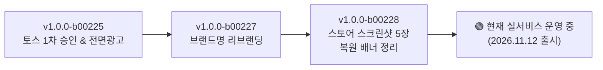
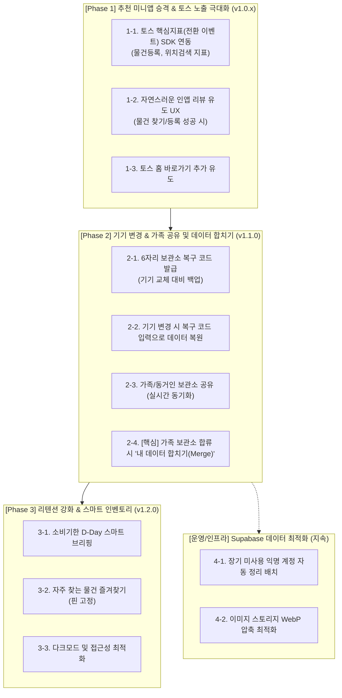

# 🗺️ '아 찾았다 · 내 물건 찾기' 개발 현황 요약 및 로드맵

---

## 📌 1. 현재까지의 개발 및 출시 현황 (As-Is)

현재 **`아 찾았다 · 내 물건 찾기`**는 토스 실서비스(Live)에 정상 배포되어 운영 중입니다.

### 1.1 주요 달성 성과
- **정식 출시 및 광고 수익화**: 토스 앱 내 정식 런칭 및 라이브 전면 광고(`ait.v2.live.41b1a3be69b94e33`) 연동 완료.
- **브랜드 정체성 확립**: 중복 앱 명칭 이슈를 해결하고 직관적인 `아 찾았다 · 내 물건 찾기`로 개편.
- **스토어 ASO(검색 최적화) 기반 마련**: 토스 규격(**636 × 1048**)에 맞춘 고화질 실기기 스크린샷 5장 등록.
- **안정적인 듀얼 데이터 아키텍처**: SQLite(로컬 고속 오프라인) + Supabase(실시간 클라우드 동기화).

---

## 💡 2. 최근 대화에서 도출된 핵심 문제 및 요구사항

| 분류 | 사용자의 질문 및 고민 | 해결 방안 |
| :--- | :--- | :--- |
| **토스 노출 극대화** | "내 미니앱 토스에 노출하기" 가이드가 있는데, 어떻게 해야 더 많은 사람에게 노출될까? | 단순 검색 노출(출시 상태)에서 벗어나 **'추천 미니앱'**으로 승격하기 위한 지표(리뷰, 전환 이벤트) 연동 |
| **데이터 안정성** | "기기 캐시/세션을 완전 초기화하거나 기기를 바꾸면 내 데이터는 어떻게 되나?" | 익명 세션 유실 방지를 위한 **'6자리 보관소 복구/공유 코드'** 및 기기 간 데이터 이전 기능 제공 |
| **가족 데이터 통합 (NEW)** | "남편과 아내가 각자 물건을 등록해 쓰다가, 나중에 가족 보관소로 합칠 때 기존 데이터는 어떻게 되나?" | 가족 보관소 합류 시 **'기존 내 데이터 함께 가져가기(Merge)'** 옵션을 제공하여 데이터 유실 없는 자연스러운 가족 통합 지원 |
| **데이터 관리** | "초기화 후 남은 불필요한 데이터가 Supabase에 계속 쌓이면 어떻게 하나?" | 방치된 익명 세션 데이터에 대한 Supabase 정리 정책 및 수명 주기(TTL) 관리 방안 수립 |
| **리텐션(재방문율)** | 유저가 물건을 등록한 후 다시 앱을 켜게 만드는 강력한 계기가 필요함 | 소비기한 임박 D-Day 강조 및 스마트 인앱 리마인더 |

---

## 🚀 3. 향후 단계별 로드맵 (To-Be)

---

### 📍 Phase 1: 추천 미니앱 승격 & 토스 노출 극대화 (버전: v1.0.1 ~ v1.0.2)
> **목표**: 토스 검색창 검색에만 의존하지 않고, 토스 앱의 **'추천 미니앱 큐레이션'** 및 **'전체/혜택 탭'**에 노출되어 자연 유입을 극대화합니다.

1. **토스 핵심지표(Conversion Event) 연동**
   - 토스 콘솔에 핵심 성과 이벤트 등록:
     - `item_created` (물건 등록 완료)
     - `item_searched` (물건 검색/위치 조회 성공)
     - `expiry_checked` (소비기한 확인)
   - 앱 내에서 해당 동작이 일어날 때 토스 Analytics SDK로 이벤트 전송.
2. **기분 좋은 타이밍의 인앱 리뷰 유도 UX**
   - 유저가 물건을 3개 이상 등록했거나, 검색으로 원하는 물건을 찾았을 때 "도움이 되셨나요?" 토스 리뷰 바텀시트 호출.
   - 높은 평점과 활성 리뷰를 축적하여 스토어 랭킹 상승.
3. **토스 홈 화면 '바로가기 추가' 유도**
   - 홈 탭 상단 또는 설정에서 토스 앱 바탕화면에 미니앱 아이콘을 바로가기로 추가할 수 있도록 지원.

---

### 📍 Phase 2: 기기 변경 지원 & 가족 공유 및 데이터 합치기 (버전: v1.1.0)
> **목표**: 폰을 바꾸거나 앱 캐시를 지워도 데이터 유실 걱정이 없고, 가족이 각자 쓰던 데이터를 하나로 깔끔하게 합쳐서 쓸 수 있도록 지원합니다.

1. **6자리 보관소 복구 코드(Recovery Code) 시스템**
   - 설정(더보기) 탭에서 내 보관소의 고유 복구 코드 확인 및 클립보드 복사 기능.
2. **새 기기에서 데이터 불러오기 플로우**
   - 최초 앱 실행 시 "이전 보관소 불러오기" 버튼 제공 ➔ 6자리 코드 입력 시 기존 데이터 즉시 동기화.
3. **가족/동거인과 함께 쓰는 공유 보관소 (`ENABLE_FAMILY_SYNC`)**
   - 동일한 코드로 접속한 가족들이 같은 집의 냉장고, 창고 물건을 실시간으로 함께 관리.
4. **🔥 [신규] 가족 보관소 합류 시 '기존 내 데이터 합치기(Merge)' 기능**
   - **문제점 방지**: 남편이 아내의 가족 코드로 들어올 때, 남편이 기존에 등록해 둔 물건이 사라지지 않도록 방지.
   - **UX 플로우**:
     - 가족 코드 입력 시 안내 팝업:  
       `"기존에 등록한 공간과 물건(OO개)을 가족 보관소로 함께 가져갈까요?"`
       - `[예, 함께 합치기]` 선택 시: 기존 데이터의 소유 보관소 ID를 가족 보관소로 자동 전환(UPDATE)하여 병합 완료.
       - `[아니오, 새로 시작]` 선택 시: 기존 데이터 분리 후 가족 보관소만 동기화.
   - **이름 충돌 방지**: 동일한 이름의 공간(예: 둘 다 '거실'이 있는 경우)은 하나로 묶거나 `거실 (기존)`으로 자동 구분 처리.

---

### 📍 Phase 3: 리텐션(재방문율) 및 스마트 기능 강화 (버전: v1.2.0)
> **목표**: 물건을 등록해 두고 잊어버리는 것이 아니라, 매주 정기적으로 앱을 열어보게 만듭니다.

1. **소비기한 임박 스마트 브리핑 (홈 탭 고도화)**
   - 유통기한이 3일/7일 남은 식료품이나 의약품을 홈 상단에 눈에 띄게 카드형으로 요약 노출.
2. **자주 찾는 물건 핀 고정 (즐겨찾기)**
   - 손톱깎이, 여권, 계절 옷 등 자주 찾는 물건을 상단에 고정해 검색 없이 1초 만에 확인.
3. **카테고리별 스마트 통계**
   - 우리 집에 보관된 물건의 총 개수, 공간별 비중, 유통기한 경과 물건 통계 시각화.

---

### 📍 Phase 4: Supabase 인프라 관리 및 데이터 거버넌스 (백엔드 운영)
> **목표**: 쌓이는 익명 세션과 이미지 용량을 효율적으로 관리하여 데이터베이스 비용과 성능을 최적화합니다.

1. **미사용 익명 계정(Orphan Data) 수명 주기 관리**
   - 90일 이상 로그인이나 동기화가 없는 빈 익명 계정 및 더미 레코드 자동 정리(Soft Delete / Cleanup SQL 트리거).
2. **이미지 리사이징 & WebP 최적화**
   - 유저가 업로드하는 물건 사진의 용량을 300KB 이내로 자동 압축하여 Supabase Storage 비용 절감 및 로딩 속도 향상.

---

## 📋 4. 우선순위 결정 매트릭스

| 우선순위 | 작업 항목 | 예상 공수 | 기대 효과 |
| :---: | :--- | :---: | :--- |
| **P0 (최우선)** | **토스 핵심지표(전환 이벤트) & 인앱 리뷰 유도** | 1~2일 | **추천 미니앱 승격**을 통한 실제 토스 유저 유입량 대폭 증가 |
| **P1 (핵심)** | **기기 변경 복구 코드 & 가족 데이터 합치기(Merge)** | 2일 | 기기 교체/초기화 시 데이터 유실 방지 및 **가족 간 데이터 완전 통합** |
| **P2 (리텐션)** | **소비기한 D-Day 스마트 브리핑** | 1일 | 매일/매주 재방문율(리텐션) 증가 |
| **P3 (최적화)** | **Supabase 미사용 데이터 정리 정책** | 반나절 | 장기 데이터 무결성 및 DB 용량 최적화 |
