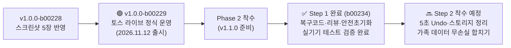
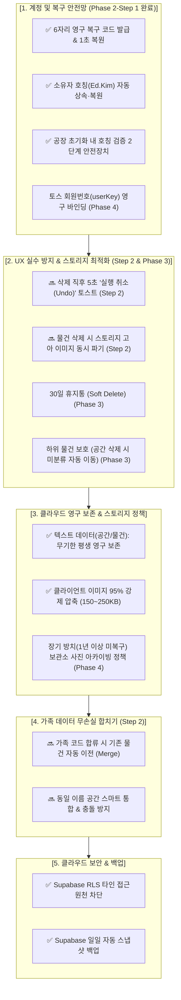
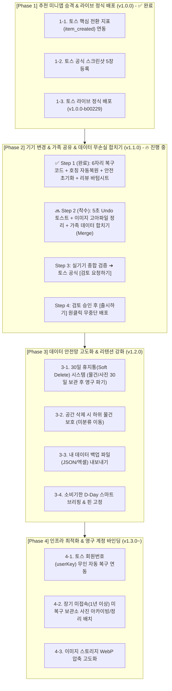

# 🗺️ '아 찾았다 · 내 물건 찾기' 마스터 종합 개발 로드맵
> **부제**: 토스 추천 미니앱 승격 전략 및 유저 데이터 100% 안전성 보장 통합 플랜  
> **최종 갱신일**: 2026-11-15 (Phase 2 - 1단계 완료 반영)

---

## 📌 1. 현재까지의 개발 및 출시 현황 (As-Is)

현재 **`아 찾았다 · 내 물건 찾기`**는 **`v1.0.0-b00229`**가 토스 실서비스(Live)에 정상 배포되어 활발히 운영 중이며, **`Phase 2 (v1.1.0)`의 1단계(Step 1: b00230~b00234)** 실기기 테스트 및 검증이 완벽하게 완료된 상태입니다.

### 1.1 주요 달성 성과
- **정식 출시 및 광고 수익화 (v1.0.0 라이브)**: 토스 앱 내 정식 런칭 및 라이브 전면 광고(`ait.v2.live.41b1a3be69b94e33`) 정상 송출.
- **공식 브랜드명 확립**: 스토어 중복 명칭 이슈를 해결하고 직관적인 `아 찾았다 · 내 물건 찾기`로 개편.
- **스토어 ASO(검색 최적화) 기반 마련**: 토스 권장 규격(**636 × 1048**)에 맞춘 고화질 실기기 스크린샷 5장 등록 완료.
- **Phase 2 1단계(Step 1) 완수 (`b00230` ~ `b00234`)**:
  - 6자리 영구 복구 코드 발급 및 1초 보관소 복원 시스템 구축
  - 복원 시 기존 소유자 호칭(**`Ed.Kim`**) 자동 상속 및 동기화
  - 대화형 인앱 리뷰 바텀시트(1~5점 별점, 키워드 칩, 햅틱 피드백) 탑재
  - 모바일 뷰포트 스크롤 제거 최적화 및 설정 폰트 규격 일원화
  - 공장 초기화 시 위험한 실행 경고 확인(내 호칭 검증) 2단계 안전장치 탑재

---

## 💡 2. 당면 핵심 과제 및 데이터 위협 요인 분석

| 영역 | 위험 시나리오 / 사용자 고민 | 해결 방안 및 현황 |
| :--- | :--- | :--- |
| **토스 노출 극대화** | 단순 검색창 노출에 머물러 신규 유저 유입이 제한됨 | **[완료]** 토스 추천 미니앱 승격을 위한 **핵심 전환 지표(`item_created`)** 및 **대화형 인앱 리뷰 바텀시트** 구축 |
| **기기 변경 / 분실** | 새 스마트폰 교체나 앱 재설치 시 데이터 유실 | **[완료]** **6자리 영구 복구 코드** 발급 및 1초 복원 (장기적 **토스 userKey 연동**) |
| **호칭 / 데이터 동기화** | 초기화 후 복구 시 사용자 닉네임이 '소유자'로 초기화 | **[완료]** 보관소 내 기존 소유자 호칭(**`Ed.Kim`**) 자동 상속·동기화 엔진 탑재 |
| **실수 초기화 방지** | 실수로 초기화 버튼을 눌러 데이터가 지워지는 사고 | **[완료]** **위험한 실행 경고 확인**: 내 호칭을 정확히 입력해야 확인창으로 진입하는 2단계 검증 |
| **사진 용량 / 고아 파일** | 물건 삭제 후에도 사진 파일이 남아 스토리지를 잠식 | **[Step 2 예정]** **물건/수납처 삭제 시 Supabase Storage 이미지 파일 동시 파기** |
| **가족 데이터 통합** | 남편과 아내가 각자 쓰다가 합칠 때 한쪽 데이터가 삭제됨 | **[Step 2 예정]** 가족 보관소 합류 시 **'기존 내 데이터 함께 가져가기(Merge)'** 지원 |
| **실수로 인한 삭제** | 공간이나 물건을 실수로 잘못 삭제했을 때 복구 불가 | **[Step 2 예정]** **삭제 직후 5초 '실행 취소(Undo)' 토스트** / **[Phase 3]** **30일 휴지통** |
| **리텐션(재방문율)** | 물건을 등록한 뒤 다시 앱을 열어볼 동기 부족 | **[Phase 3]** **소비기한 임박 D-Day 스마트 브리핑** 및 자주 찾는 물건 핀 고정 |

---

## 🛡️ 3. 유저 데이터 100% 안전 보장을 위한 5대 핵심 안전망

---

## 🚀 4. 통합 단계별 개발 로드맵 (To-Be)

---

### 📍 Phase 1: 추천 미니앱 승격 & 토스 노출 극대화 [✅ 100% 완료 (2026.11.14)]
1. **토스 핵심 전환 지표(`item_created`) 연동 및 콘솔 등록 [완료]**
   - 토스 콘솔 활성 지표 및 대표 전환 지표(`물건 등록 완료 (item_created)`) 등록 완료.
   - 앱 내 물건 등록(`item_created`), 검색(`item_searched`), 유통기한 확인(`expiry_viewed`) 지표 실시간 로깅.
2. **토스 공식 인앱 리뷰(`Review.request`) 스마트 유도 UX [완료]**
   - 물건 1회, 3회, 7회 등록 시 및 검색 성공 시 자동 호출 (14일 쿨다운 보호).
3. **스토어 공식 규격(636 × 1048) 실기기 스크린샷 5장 반영 [완료]**
4. **실서비스(Live) 정식 배포 완료 [완료]** (`v1.0.0-b00229`)

---

### 📍 Phase 2: 기기 변경 지원 & 가족 공유 및 데이터 무손실 합치기 (버전: v1.1.0) [🔥 진행 중]
> **목표**: 폰을 바꾸거나 앱 캐시를 지워도 데이터 유실 걱정이 없고, 가족이 각자 쓰던 데이터를 하나로 깔끔하게 합쳐서 쓸 수 있도록 지원합니다.

#### ✅ Step 1 (1단계: 핵심 데이터 복구 & 복원 안전망) [100% 완료 (`b00230` ~ `b00234`)]
1. **6자리 영구 복구 코드(Recovery Code) 시스템 [완료]**
   - 설정 탭에서 고유 복구 코드 확인 및 원클릭 복사.
   - 새 기기나 캐시 삭제 후 복구 코드 입력 시 1초 만에 전체 공간/수납처/물건 복원.
2. **소유자 호칭(`Ed.Kim`) 자동 상속·복원 시스템 [완료]**
   - 앱 초기화 후 복구 시 세션이 달라져도 기존 보관소 소유자 호칭을 자동 조회하여 즉각 상속·복구.
3. **공장 초기화 시 '위험한 실행 경고 확인' 및 내 호칭 검증 절차 [완료]**
   - 1단계 경고 바텀시트에서 현재 내 호칭(**`Ed.Kim`**)을 정확히 입력해야만 2단계 확인창으로 진입하는 안전장치.
4. **대화형 인앱 리뷰 바텀시트 신규 탑재 [완료]**
   - 1~5점 별점 인터랙션, 만족 키워드 칩, 응원 메시지 작성, 햅틱 피드백 지원.
5. **설정 화면 뷰포트 최적화 & 타이포그래피 정렬 [완료]**
   - 모바일 한눈 뷰포트(스크롤 불필요) 완성 및 다른 설정 메뉴와 동일한 표준 폰트 규격 일원화.

#### 🔜 Step 2 (2단계: 데이터 실수 방지 & 스토리지 최적화 & 가족 무손실 합치기) [다음 착수 예정]
1. **5초 삭제 실행 취소(Undo) 토스트**
   - 물건이나 공간 삭제 시 화면 하단에 5초간 `[실행 취소]` 버튼을 노출하여 탭 한 번으로 즉시 원상 복구.
2. **물건/수납처 삭제 시 스토리지 고아 이미지(Orphan File) 동시 파기 [신규 반영]**
   - 유저가 물건/수납처를 삭제하면 DB뿐 아니라 Supabase Storage(`item-images`)에 저장된 이미지 파일도 함께 삭제하여 스토리지 용량 누수 원천 차단.
3. **가족 보관소 합류 시 '내 데이터 무손실 합치기(Merge)' 기능**
   - 남편이 아내의 가족 코드로 합류할 때 기존에 등록해 둔 남편의 물건들이 삭제되지 않도록 보호.
   - 코드 입력 시 모달: *"기존에 등록한 내 공간과 물건(OO개)을 가족 보관소로 함께 가져갈까요?"*
   - `[예, 함께 합치기]` 선택 시: 소유 ID를 가족 보관소로 일괄 자동 전환하여 무손실 병합.
4. **가족 보관소 실시간 공유 기능 오픈 (`ENABLE_FAMILY_SYNC = true`)**

#### 📋 Step 3 (3단계: 실기기 종합 테스트 & 토스 공식 검토 요청)
1. Tauriqon님의 휴대폰 토스 앱에서 비공개 QR 스캔으로 4대 핵심 시나리오 실기기 최종 검증.
2. 이상 없음 확인 시 토스 콘솔에서 **`v1.1.0` 공식 [검토 요청하기]** 제출. (기존 v1.0.0 무중단 라이브 유지)

#### 🚀 Step 4 (4단계: 승인 후 공식 출시)
1. 토스 승인 메일 수신 즉시 콘솔 [출시하기] 클릭으로 실시간 무중단 배포. (문제 발생 시 1초 롤백 안전망)

---

### 📍 Phase 3: 데이터 안전망 고도화 & 리텐션 강화 (버전: v1.2.0)
> **목표**: 휴지통 시스템으로 실수 삭제를 완벽히 방지하고, 소비기한 알림으로 지속적인 재방문을 만듭니다.

1. **30일 휴지통(Soft Delete) 시스템**
   - 삭제된 항목은 DB에서 영구 삭제되지 않고 `deleted_at` 처리되어 30일간 보관.
   - 설정 내 **[휴지통]** 메뉴에서 원클릭으로 완벽 복원.
   - 30일 경과 시 텍스트 및 연결된 스토리지 이미지 파일 완전 자동 파기.
2. **공간 삭제 시 하위 물건 보호**
   - 물건이 들어있는 공간/수납처 삭제 시 물건이 함께 증발하지 않고 **[미분류 보관함]**으로 자동 안전 이동.
3. **내 데이터 백업 파일(JSON/엑셀) 내보내기/가져오기**
   - 유저가 원할 때 언제든 내 물건 전체 목록을 파일로 다운로드하여 개인 소장 가능.
4. **소비기한 D-Day 스마트 브리핑 & 핀 고정**
   - 유통기한 3일/7일 남은 물건 홈 상단 브리핑.
   - 자주 찾는 물건(손톱깎이, 여권 등) 홈 상단 즐겨찾기 고정.

---

### 📍 Phase 4: 인프라 최적화 & 영구 계정 바인딩 (버전: v1.3.0 ~ 지속)
> **목표**: 토스 로그인 연동으로 복구 코드조차 필요 없는 무인 자동 복구를 실현하고, DB 비용과 성능을 최적화합니다.

1. **토스 회원번호(`userKey`) 기반 100% 무인 자동 복구 연동**
   - 토스 계정과 보관소를 1:1로 영구 바인딩하여, 폰을 바꾸든 앱을 재설치하든 별도 입력 없이 자동 복구.
2. **데이터 분리 보존 및 스토리지 수명 주기 관리 [신규 반영]**
   - **텍스트 데이터(물건/공간/메모)**: 용량이 극히 작으므로(수십 KB) 평생 무기한 영구 보존.
   - **장기 방치 사진 정리 정책**: 1년 이상 접속이 전혀 없는 미복구 보관소의 사진에 한해 아카이빙/정리 배치 도입.
3. **이미지 스토리지 WebP 압축 고도화**
   - 업로드 사진을 초경량 WebP 포맷으로 압축하여 로딩 속도 2배 향상 및 스토리지 사용량 추가 30% 절감.

---

## 📋 5. 종합 우선순위 결정 매트릭스

| 우선순위 | 작업 항목 | 진행 상태 | 기대 효과 |
| :---: | :--- | :---: | :--- |
| **P0 (최우선)** | **토스 핵심 전환 지표 & 인앱 리뷰 인프라** | **✅ 완료 (Phase 1)** | **추천 미니앱 승격**을 통한 실제 토스 유저 유입량 대폭 증가 |
| **P0 (안전)** | **6자리 복구 코드 & 소유자 호칭 복원 & 안전 초기화** | **✅ 완료 (Phase 2-Step 1)** | 기기 교체/초기화 시 데이터 100% 보존 및 실수 초기화 원천 차단 |
| **P1 (핵심)** | **5초 Undo & 스토리지 고아파일 정리 & 가족 데이터 합치기(Merge)** | **🔜 착수 예정 (Phase 2-Step 2)** | 실수 삭제 즉시 복구, **스토리지 용량 누수 방지**, **가족 간 데이터 완전 통합** |
| **P2 (안전/리텐션)** | **30일 휴지통(Soft Delete) & 소비기한 D-Day 브리핑** | 대기 (Phase 3) | 실수 삭제 완벽 복원 및 매일/매주 재방문율(리텐션) 증가 |
| **P3 (고도화/운영)** | **토스 userKey 영구 바인딩 & 장기 방치 사진 수명주기 관리** | 대기 (Phase 4) | 무인 자동 복구 완성 및 장기 클라우드 비용/성능 최적화 |
