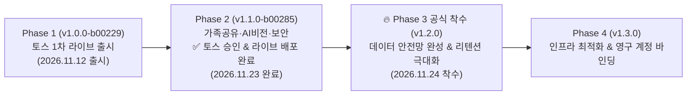
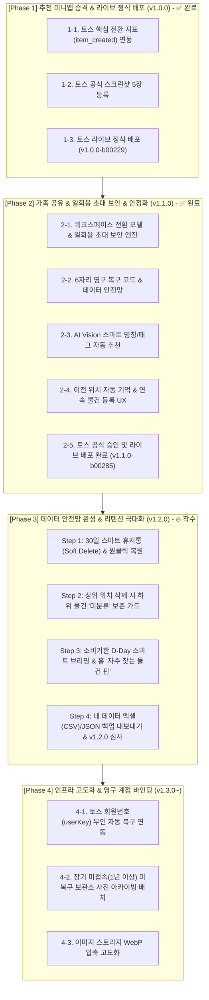

# 🗺️ '아 찾았다 · 내 물건 찾기' 마스터 종합 개발 로드맵
> **부제**: 토스 추천 미니앱 승격 전략 및 유저 데이터 100% 안전성 보장 통합 플랜  
> **최종 갱신일**: 2026-11-24 (Phase 3 공식 착수 - 데이터 안전망 완성 & 리텐션 극대화 플랜 v1.2.0)

---

## 📌 1. 현재까지의 개발 및 출시 현황 (As-Is)

현재 **`아 찾았다 · 내 물건 찾기`**는 **`Phase 1 (v1.0.0-b00229)`**에 이어 **`Phase 2 (v1.1.0-b00285)`**가 토스 공식 심사 승인을 통과하여 **실서비스(Live)에 무중단 라이브 배포**되었습니다.

이제 우리는 서비스의 장기적인 리텐션(재방문율)을 극대화하고 유저 데이터 유실을 0%로 완벽 차단하는 **`Phase 3 (v1.2.0)`** 개발에 공식 착수합니다.

### 1.1 Phase 2 완수 주요 성과 (`v1.1.0-b00285` 라이브 배포)
1. **가족 공유 & 워크스페이스 전환 모델 탑재**:
   - 기존 병합(Merge) 방식을 완전 폐기하고 개인 보관소를 100% 보존하는 **워크스페이스 전환(Switching)** 모델 도입
   - 홈 헤더 및 설정에서 원터치 1초 전환 (`[가족 보관소] ↔ [내 개인 보관소]`)
   - 안전 탈퇴 시 개인 보관소 원형 100% 복귀 및 메신저 스마트 코드 자동 추출
2. **일회용 초대 코드 보안 엔진 분리**:
   - 마스터 복구키(소유자 영구 보관)와 가족 초대 코드(1회용 소모품 티켓) 완전 분리
   - 1회 승인 시 즉시 소멸(Used), 24시간 만료(TTL), 재발급 지원
3. **6자리 영구 마스터 복구 코드 발급 & 1초 복원**:
   - 기기 변경이나 앱 재설치 시에도 6자리 코드로 데이터 및 소유자 호칭(**`Ed.Kim`**) 1초 복원
   - 2단계 공장 초기화 안전장치 및 인앱 리뷰 바텀시트 탑재
4. **AI Vision 스마트 명칭/태그 추천**:
   - Google Gemini AI 실시간 연동: 사진 촬영 시 물건 명칭과 카테고리 태그 자동 추천
5. **연속 물건 등록 편의성 혁신**:
   - 이전 저장 위치(공간-수납처-세부위치 3단계) 자동 기억으로 반복 입력 제거
   - 저장 완료 후 스크롤 최상단(Top) 자동 이동
6. **실기기 성능 및 모바일 최적화**:
   - 카메라 고화질 사진 메모리 크래시 방지 (Blob URL + 1024px 선제 압축)
   - 목록 내 한 줄 메모 노출 및 상단 브레드크럼 스크롤 고정(`sticky`)
   - 토스 심사 기준 준수: 내비게이션 바 중복 뒤로가기 버튼 제거(`withBackButton: false`) 및 가상 키보드 선제 해제(`blur`)

---

## 💡 2. Phase 3 당면 핵심 과제 및 기회 요인 분석

| 영역 | 현황 및 사용자 고민 | Phase 3 해결 방안 (v1.2.0) |
| :--- | :--- | :--- |
| **장기 실수 삭제 위험** | 5초 Undo가 지나가면 실수로 삭제한 물건/수납처를 되돌릴 방법이 없음 | **[3-1] 30일 스마트 휴지통 (Soft Delete)** • 삭제된 데이터를 즉시 파기하지 않고 30일간 휴지통에 안전 보관 • 설정 탭 내 휴지통에서 언제든 원클릭 복원 지원 |
| **상위 위치 삭제 시 대량 유실** | 수납처나 공간을 삭제하면 하위 물건이 전부 함께 삭제(Cascade)되는 위험 | **[3-2] 하위 물건 '미분류' 보존 가드** • 수납처 삭제 시 "물건도 함께 삭제" vs "미분류로 이동" 선택 제공 • 미분류 물건 탭/필터 및 새 위치 원터치 재지정 UX |
| **리텐션(재방문율) 부족** | 물건을 등록한 뒤 앱을 매일/매주 다시 열어볼 뚜렷한 동기가 부족함 | **[3-3] 소비기한 D-Day 스마트 브리핑** • 유통기한 D-7, D-3, D-Day 임박 물건을 홈 최상단에 브리핑 위젯으로 노출 • 상비약/식료품 소비 주기를 챙기기 위해 자연스러운 재방문 유도 |
| **자주 쓰는 물건 접근성** | 차키, 여권, 영양제 등 자주 찾는 핵심 물건을 검색 없이 1초 만에 확인 원함 | **[3-3] 홈 상단 '자주 찾는 물건 핀(Pin)'** • 물건 상세에서 핀 고정 시 홈 화면 상단 퀵 슬라이더로 즉시 노출 |
| **데이터 소유권 불안감** | "앱이 사라지거나 기기를 바꾸면 내 데이터는 안전할까?" 유저 심리적 불안 | **[3-4] 내 데이터 파일(CSV/JSON) 내보내기** • 내 모든 보관소/수납처/물건 데이터를 엑셀(CSV) 또는 JSON 파일로 스마트폰에 다운로드/저장 |

---

## 🛡️ 3. 유저 데이터 100% 안전 보장을 위한 5대 핵심 안전망 (Phase 3 고도화)

```mermaid
flowchart TD
    subgraph S1["[1. 계정 및 복구 안전망 (완료)]"]
        S1_1["✅ 6자리 영구 마스터 복구 코드 발급 & 1초 복원"]
        S1_2["✅ 소유자 호칭(Ed.Kim) 자동 상속·복원"]
        S1_3["✅ 공장 초기화 내 호칭 검증 2단계 안전장치"]
        S1_4["✅ 일회용 초대 코드 엔진 (1회 승인 시 즉시 소멸)"]
    end

    subgraph S2["[2. UX 실수 방지 & 다중 안전망 (Phase 3)]"]
        S2_1["✅ 수정 중 이탈 시 미저장 롤백 & 확인 팝업"]
        S2_2["✅ 삭제 직후 5초 1차 안전망 '실행 취소(Undo)' 토스트"]
        S2_3["🔥 2차 안전망: 30일 스마트 휴지통(Soft Delete) 시스템 (Phase 3)"]
        S2_4["🔥 위치 삭제 시 하위 물건 '미분류' 보존 가드 (Phase 3)"]
    end

    subgraph S3["[3. 클라우드 영구 보존 & 데이터 주권 (Phase 3)]"]
        S3_1["✅ 텍스트 데이터: 무기한 평생 영구 보존"]
        S3_2["✅ Blob URL 도입 및 1024px 선제 압축 (메모리 안정화)"]
        S3_3["🔥 내 데이터 엑셀(CSV)/JSON 파일 백업 내보내기 (Phase 3)"]
        S3_4["장기 방치(1년 이상) 미복구 보관소 아카이빙 정책 (Phase 4)"]
    end

    subgraph S4["[4. 가족 보관소 분리 보존 & 원클릭 전환 (완료)]"]
        S4_1["✅ 데이터 병합(Merge) 완전 폐기 ➔ 오염 원천 차단"]
        S4_2["✅ 가족 합류 시 기존 데이터는 [내 개인 보관소]로 100% 안전 보존"]
        S4_3["✅ 홈 헤더/설정에서 [가족 보관소] ↔ [내 개인 보관소] 1초 전환"]
        S4_4["✅ 가족 보관소 탈퇴 시 내 개인 보관소 100% 안전 복귀"]
    end

    subgraph S5["[5. 리텐션 & 스마트 브리핑 (Phase 3)]"]
        S5_1["🔥 홈 최상단 소비기한 임박 D-Day 스마트 브리핑 (Phase 3)"]
        S5_2["🔥 자주 찾는 핵심 물건 홈 화면 상단 핀(Pin) 고정 (Phase 3)"]
    end

    S1 --> S2
    S2 --> S3
    S3 --> S4
    S4 --> S5
```

---

## 🚀 4. 통합 단계별 개발 로드맵 (Phase 3 중심)

---

## 📍 5. Phase 3 상세 실행 계획 (`v1.2.0`)

### 1단계 (Step 1): 30일 스마트 휴지통(Soft Delete) & 원클릭 복원 시스템
- **데이터 삭제 패러다임 전환**:
  - 기존: 즉시 파기(Hard Delete) + 5초 Undo 토스트.
  - 개선: 5초 Undo 토스트 유지 + 5초 경과 시 DB 레코드에 `deleted_at = now()` 타임스탬프를 부여하는 **Soft Delete** 적용.
- **설정 내 `[🗑️ 휴지통]` 메뉴 신설**:
  - 삭제된 물건 및 수납처 목록 열람.
  - 남은 보관 기간 뱃지 표시 (`30일 남음` ~ `1일 남음`).
- **원클릭 복원 & 즉시 영구 삭제**:
  - `[복원하기]` 클릭 시 원래 위치(공간/수납처)로 즉시 롤백 복구.
  - `[휴지통 비우기]` 클릭 시 DB 및 Supabase Storage 이미지 영구 파기.
  - 30일 경과 데이터는 자동 영구 파기(Purge).

### 2단계 (Step 2): 상위 위치 삭제 시 하위 물건 보호 ('미분류' 보존 가드)
- **Cascade 삭제 방지 안전 인터랙션**:
  - 수납처나 공간 삭제 시 하위 물건이 존재하면 즉시 지우지 않고 확인 팝업 노출:
    - `[옵션 A]` **"하위 물건 N개도 함께 삭제 (휴지통으로 이동)"**
    - `[옵션 B]` **"하위 물건 N개를 '미분류'로 안전하게 보관 (권장)"**
- **미분류(Uncategorized) 물건 관리 UX**:
  - 탐색 탭 최상단 또는 필터에 `[보관위치 미지정 물건]` 칩 제공.
  - 미분류 물건 상세에서 새 공간/수납처로 원터치 재지정 지원.

### 3단계 (Step 3): 소비기한 D-Day 스마트 브리핑 & 홈 '자주 찾는 물건 핀(Pin)'
- **홈 탭 최상단 소비기한 임박 스마트 브리핑 위젯**:
  - 유통기한 D-7, D-3, D-Day, 만료 임박 물건을 감지하여 홈 최상단에 컴팩트한 알림 카드로 노출.
  - 탭 시 해당 물건 상세 바텀시트가 즉시 열리며, 냉장고/약통 관리를 위해 매일 앱을 켜볼 강력한 리텐션 동기 부여.
- **자주 찾는 물건 📌 핀(Pin) 고정 기능**:
  - 물건 상세 바텀시트에서 `[📌 자주 찾는 물건으로 고정]` 토글 버튼 추가.
  - 홈 화면 상단에 핀 고정 물건 가로 스크롤 카드 배치 -> 검색창을 누를 필요도 없이 1초 만에 위치 확인.

### 4단계 (Step 4): 내 데이터 백업 파일(CSV/JSON) 내보내기 & v1.2.0 출시
- **데이터 백업 파일 생성 및 공유**:
  - 설정 탭 내 `[내 데이터 파일로 백업받기]` 기능 신설.
  - 현재 보관소의 전체 구조(공간, 수납처, 물건 목록, 메모, 유통기한)를 `Excel 호환 CSV` 또는 `JSON` 파일로 생성.
  - 토스 `share` 브릿지 또는 파일 다운로드를 통해 카카오톡, 이메일, 단말기 로컬 파일함으로 내보내기 지원.
- **Phase 3 종합 QA 및 토스 3차 공식 심사 제출**:
  - `v1.2.0` 번들 빌드 및 심사 승인 후 무중단 라이브 배포.

---

## 📋 6. Phase 3 우선순위 결정 매트릭스

| 우선순위 | 작업 항목 | 대상 마일스톤 | 기대 효과 |
| :---: | :--- | :---: | :--- |
| **P0 (안전망)** | **30일 스마트 휴지통(Soft Delete) & 원클릭 복원** | **Phase 3 - Step 1** | 실수 삭제 100% 복구 가능, 유저 데이터 유실 불안 완전 해소 |
| **P0 (안전망)** | **상위 위치 삭제 시 하위 물건 '미분류' 보존 가드** | **Phase 3 - Step 2** | 실수로 수납처 삭제 시 수십 개 물건 동시 증발 사고 원천 방지 |
| **P1 (리텐션)** | **소비기한 D-Day 스마트 브리핑 카드** | **Phase 3 - Step 3** | 상비약/식료품 주기 알림으로 일간/주간 재방문율(리텐션) 비약적 상승 |
| **P1 (UX)** | **홈 상단 '자주 찾는 물건 📌 핀(Pin)' 고정** | **Phase 3 - Step 3** | 차키/여권 등 빈번한 물건 1초 즉시 확인으로 사용 편의성 극대화 |
| **P1 (신뢰)** | **내 데이터 백업 파일(CSV/JSON) 내보내기** | **Phase 3 - Step 4** | 유저 데이터 주권 보장 및 서비스 신뢰도 제고 |
| **P2 (고도화)** | **토스 userKey 영구 바인딩 & 클라우드 수명주기** | 대기 (Phase 4) | 무인 자동 계정 바인딩 및 장기 클라우드 인프라 최적화 |

---

## 📊 7. 전체 단계별 버전 및 마일스톤 요약표

| 단계 | 버전 | 핵심 마일스톤 | 현 상태 |
| :--- | :---: | :--- | :---: |
| **Phase 1** | `v1.0.0-b00229` | 토스 실서비스 첫 런칭, 인벤토리 기본기, 전면 광고 수익화 | **✅ 라이브 운영 중** |
| **Phase 2** | `v1.1.0-b00285` | 가족 공유(워크스페이스), 일회용 초대 보안, 영구 복구코드, AI 비전, 연속등록 | **✅ 토스 승인 & 라이브 배포 완료** |
| **Phase 3** | **`v1.2.0`** | **30일 스마트 휴지통, 미분류 물건 보호, 소비기한 D-Day 브리핑, 핀 고정, CSV 백업** | **🔥 공식 착수 (현재)** |
| **Phase 4** | `v1.3.0` | 토스 회원번호(userKey) 무인 자동 연동, 1년 이상 방치 보관소 아카이빙 | 🔜 Phase 3 완료 후 예정 |
