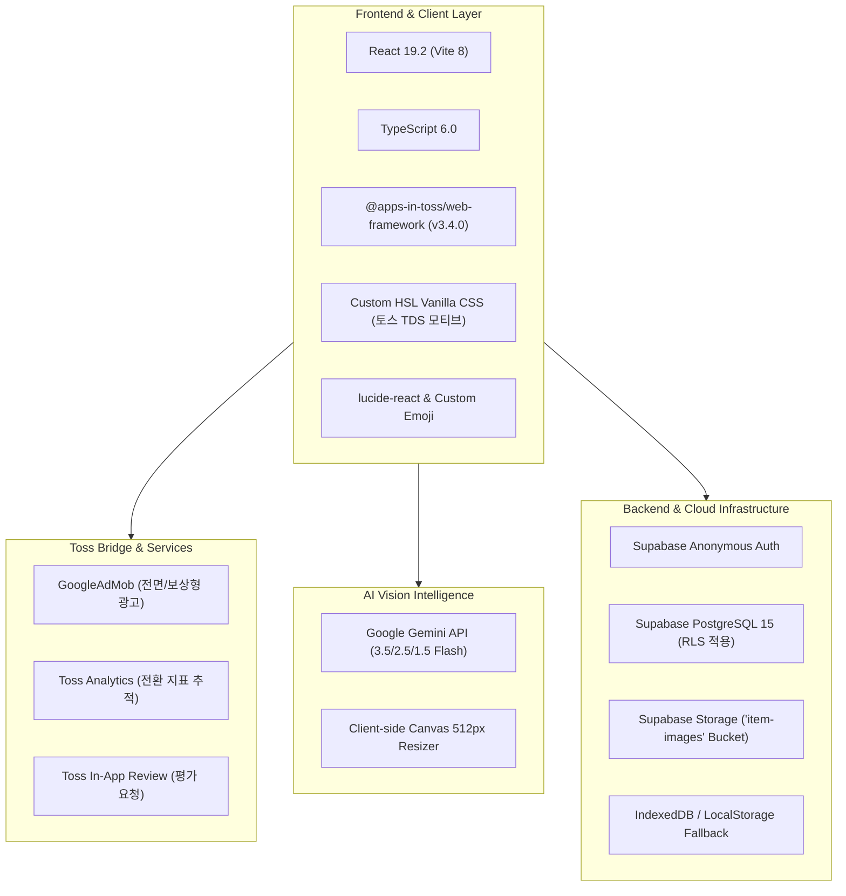
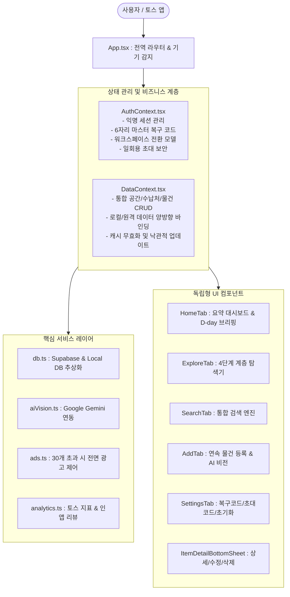
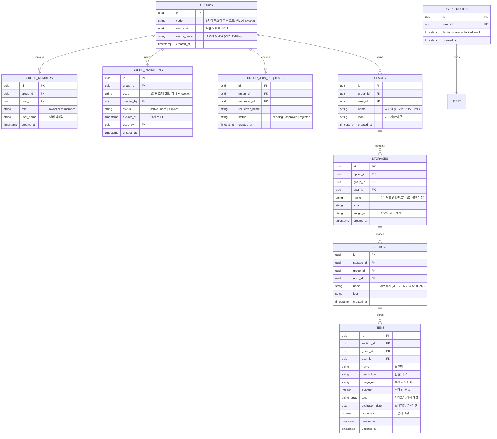

# 📘 '아 찾았다 · 내 물건 찾기' 공식 기술 명세 및 개발 요약서
> **부제**: 토스(Apps in Toss) 공식 미니앱 아키텍처 백서 & Gemini 신규 기획/설계 참조 가이드  
> **공식 서비스명**: 아 찾았다 · 내 물건 찾기 (영문 프로젝트명: `where-is-it` / 토스 등록명: `family-inventory`)  
> **현재 릴리즈 버전**: `v1.1.0-b00285` (토스 공식 심사 승인 및 무중단 라이브 배포 완료)  
> **차기 로드맵**: Phase 3 (`v1.2.0`) — 데이터 안전망 완성 & 리텐션 극대화  
> **최종 갱신일**: 2026-11-27  

---

## Executive Summary (경영 및 제품 요약)

**'아 찾았다 · 내 물건 찾기'**는 대한민국 1등 금융 슈퍼앱 **토스(Toss)**의 공식 미니앱 생태계(**Apps in Toss / Granite**)에 탑재된 모바일 퍼스트 사물 위치·유통기한·가족 공유 관리 서비스입니다.

복잡한 회원가입 없이 토스 인앱에서 즉시 구동되며, **"공간 ➔ 수납처 ➔ 수납칸 ➔ 물건"**으로 이어지는 직관적인 4단계 물리 계층 탐색, **Google Gemini 기반 AI Vision**을 통한 1초 사진 자동 품목/태그 인식, **6자리 영구 마스터 복구 코드** 및 **일회용 초대 보안 엔진**, 그리고 개인 데이터 오염을 원천 차단하는 **워크스페이스 전환 모델**을 제공합니다.

본 문서는 **새로운 AI 기반 태스크(Gemini Task) 및 차세대 서비스 확장을 위한 공식 기술 명세서**로서, 시스템 아키텍처, 데이터 모델, 핵심 비즈니스 로직, 모바일 웹뷰 최적화 기술, 수익화 정책, 그리고 차기 확장 계획을 총망라합니다.

---

## 1. 프로젝트 기본 정보 및 플랫폼 환경

| 항목 | 상세 내용 |
| :--- | :--- |
| **서비스 명칭** | **아 찾았다 · 내 물건 찾기** |
| **프로젝트 코드명** | `where-is-it` (내부 저장소 식별자) |
| **토스 콘솔 앱 식별자** | `family-inventory` |
| **타깃 플랫폼** | 토스 인앱 웹뷰 (Apps in Toss / Granite Framework), 모바일 웹 |
| **현재 라이브 버전** | `v1.1.0 (b00285)` |
| **브랜드 컬러** | Primary: `#3182f6` (토스 블루), Background: 토스 라이트/다크 HSL 시스템 |
| **권한(Permissions)** | 카메라(`camera: access`), 사진 앨범(`photos: read`) |
| **네비게이션 바 정책** | `withTitle: false`, `withBackButton: false` (토스 UX 가이드라인 준수) |

---

## 2. 기술 스택 (Technology Stack)



### 2.1 프론트엔드 (Frontend)
- **Framework & Runtime**: React 19.2, TypeScript 6.0, Vite 8
- **Toss Integration**: `@apps-in-toss/web-framework` v3.4.0, `@apps-in-toss/cli` (Granite)
- **Styling Architecture**: 순수 CSS 변수(CSS Variables)와 HSL 컬러 팔레트 기반의 반응형 디자인. 외부 무거운 UI 라이브러리 의존성 없이 토스 특유의 섬세한 터치 피드백, 부드러운 트랜지션, 스프링 인터랙션을 100% 네이티브급으로 구현.
- **Icons**: `lucide-react` 및 시각인지도가 높은 커스텀 이모지 아이콘 시스템.

### 2.2 백엔드 및 인프라 (Backend & Storage)
- **Database**: Supabase (PostgreSQL 15)
- **Authentication**: Supabase 익명 인증(Anonymous Sign-In) 기반의 무가입 원터치 세션 생성.
- **Storage**: Supabase Storage (`item-images` Public Bucket), 클라이언트 사전 압축(1024px JPEG) 연동.
- **Offline / Local Fallback**: 네트워크 단절 시에도 완벽 동작하는 LocalStorage / IndexedDB 추상화 레이어 (`dbService`).

### 2.3 AI 비전 엔진 (AI Vision Engine)
- **Model**: Google Gemini API (`gemini-3.5-flash-lite`, `gemini-3.5-flash`, `gemini-2.5-flash`, `gemini-1.5-flash` 캐스케이딩 폴백)
- **Preprocessing**: 캔버스 기반 512px JPEG 압축 전처리로 1초 이내 전송 및 토큰 소모 최소화.

---

## 3. 시스템 아키텍처 및 데이터 흐름



---

## 4. 데이터 모델 및 데이터베이스 스키마 (ERD)

### 4.1 계층 구조 및 엔티티 관계도 (ERD)



### 4.2 핵심 TypeScript 인터페이스 명세 (`src/types/index.ts`)

```typescript
export interface Space {
  id: string;
  user_id: string;
  group_id?: string;
  name: string;
  icon: string;
  created_at: string;
}

export interface StorageUnit {
  id: string;
  space_id: string;
  user_id: string;
  group_id?: string;
  name: string;
  icon: string;
  image_url?: string;
  created_at: string;
}

export interface Section {
  id: string;
  storage_id: string;
  user_id: string;
  group_id?: string;
  name: string;
  icon?: string;
  image_url?: string;
  created_at: string;
}

export interface Item {
  id: string;
  section_id: string;
  user_id: string;
  group_id?: string;
  name: string;
  description?: string;
  image_url?: string;
  quantity: number;
  tags: string[];
  created_at: string;
  updated_at: string;
  expiration_date?: string | null;
  is_private?: boolean;
}

export interface Group {
  id: string;
  code: string; // 6자리 영구 마스터 복구 코드 (wii-xxxxxx)
  owner_id: string;
  owner_name?: string | null;
  created_at: string;
}

export interface GroupInvitation {
  id: string;
  group_id: string;
  code: string; // 1회용 소모성 초대 코드
  created_by: string;
  status: 'active' | 'used' | 'expired';
  expires_at: string; // 24시간 TTL
  used_by?: string | null;
  created_at: string;
}
```

---

## 5. 핵심 비즈니스 로직 및 차별화 구현 사례

### 5.1 가족 공유: '워크스페이스 전환(Switching)' 모델
- **과거 문제**: 여러 사용자가 가족 보관소에 합류할 때 기존 개인 보관소 데이터를 강제로 합치는(Merge) 방식을 사용할 경우 데이터 오염, 키 충돌, 탈퇴 시 데이터 파기 문제가 발생함.
- **해결책**: 개인 보관소를 100% 원형 보존한 상태에서, 홈 화면 및 설정에서 `[내 개인 보관소] ↔ [가족 보관소]`를 1초 만에 원터치 전환할 수 있는 **Slack/Notion 방식의 멀티 워크스페이스 아키텍처**를 완성함.
- **안전 탈퇴 보장**: 가족 보관소를 탈퇴하거나 강퇴당하더라도, 원래 본인의 개인 보관소로 온전히 복귀하며 등록했던 개인 물건은 안전하게 유지됨.

### 5.2 2-Tier 보안 인증 및 영구 데이터 복구 시스템
1. **Tier 1: 6자리 영구 마스터 복구 코드 (`wii-xxxxxx`)**:
   - 보관소 생성 시 고유 6자리 영구 복구 코드가 발급됨.
   - 기기 변경, 앱 재설치, 브라우저 캐시 삭제 시에도 이 코드를 입력하면 1초 만에 모든 데이터와 소유자 호칭(**`Ed.Kim`**)을 복원.
2. **Tier 2: 일회용 초대 코드 보안 엔진 (One-Time Ticket)**:
   - 외부 가족이나 룸메이트를 초대할 때 영구 마스터 복구 코드를 노출하지 않음.
   - 별도의 일회용 초대 코드(`inv-xxxxxx`)가 발급되며, 1회 승인 시 즉시 `used` 상태로 소멸하고 24시간 만료(TTL) 정책을 적용하여 외부 유출을 원천 차단.
3. **소유자 호칭 자가 치유(Self-Healing)**:
   - 과도한 호칭 덮어쓰기 버그를 방지하고 멤버 참여 시 로컬 호칭과 소유자 호칭을 정밀 분리하여 무결성 유지.
4. **2단계 공장 초기화 가드**:
   - 데이터 전체 삭제 시 단순 버튼 클릭이 아닌, 소유자의 닉네임을 정확히 직접 타이핑해야 실행되는 안전장치 탑재.

### 5.3 Google Gemini AI Vision 기반 실시간 자동 인식
- **문제**: 모바일에서 물건을 일일이 타이핑하여 등록하는 것은 높은 이탈율의 주원인.
- **해결책**: 카메라로 물건을 찍는 즉시 백그라운드에서 Google Gemini 모델이 1회의 API 호출로 **물건의 대표 명칭(1~3단어 한국어 명사)과 카테고리 태그 2~3개**를 자동 추출하여 폼에 자동 입력.
- **성능 최적화**: 
  - 원본 고화질 사진(5~10MB)을 캔버스 API로 512px 초경량 JPEG(30~50KB)로 선제 압축.
  - 네트워크 전송 속도 1초 내외 단축 및 토큰 낭비 방지.
  - 최신 Flash 계열 모델 캐스케이딩 호출 (`gemini-3.5-flash-lite` ➔ `gemini-3.5-flash` ➔ `gemini-2.5-flash` ➔ `gemini-1.5-flash`).
  - JSON 응답 파싱 실패 시 정규식 기반 정밀 추출 및 단일 텍스트 정제 폴백 3중 가드 탑재.

### 5.4 모바일 웹뷰(Toss WebView) 고질병 완벽 극복 노하우
1. **1024px 선제 압축 및 Blob URL 도입**:
   - 모바일 웹뷰에서 Base64 고용량 이미지를 다수 렌더링하면 메모리 부족으로 웹뷰 프로세스가 크래시(Crash)되는 현상 발생.
   - `imageCompressor.ts`를 통해 클라이언트 사이드에서 즉시 1024px JPEG로 압축 후 Blob URL을 생성하여 메모리 점유율을 90% 이상 절감.
2. **iOS Safari/웹뷰 포커스 배율 왜곡 방지 (`activeElement.blur()`)**:
   - 가상 키보드가 열린 상태에서 하단 탭을 전환하면 뷰포트 배율이 축소 고착되는 문제를 방지하기 위해 탭 전환 즉시 강제 `blur()` 처리.
3. **미디어 쿼리 한계 극복을 위한 JS 기기 감지 시스템**:
   - 가상 키보드 팝업 시 리플로우로 뷰포트 폭이 769px 이상으로 오인되어 PC 프레임으로 찌그러지는 현상을 방지하고자, `maxTouchPoints` 및 `userAgent` 기반의 JS 감지로 모바일 풀스크린 상태를 영구 고정.
4. **연속 물건 등록 편의성 (Sticky Location & Scroll to Top)**:
   - 같은 공간/수납처에 물건을 연속해서 넣을 때 매번 위치를 다시 고르지 않도록 직전 저장 위치(공간-수납처-세부위치 3단계)를 자동 기억.
   - 저장 완료 후 스크롤을 최상단으로 자동 복귀시켜 즉각적인 연속 입력 유도.

### 5.5 수익화(AdMob) 및 토스 전환 지표(Analytics)
1. **사용자 친화적 전면 광고 정책 (`services/ads.ts`)**:
   - **타깃 조건**: 등록 물건 30개 미만 유저는 광고 완전 면제 (온보딩 경험 보호).
   - **노출 빈도**: 30개 이상 유저에게만 물건 등록/수정 5회마다 1회, 검색 상세 조회 7회마다 1회 노출.
   - **엄격한 쿨다운**: 직전 광고 송출 후 **최소 5분(300초)** 쿨다운 강제.
   - **사전 안내 UX**: 돌발 팝업 방지를 위해 "잠시 후 안내 광고가 표시됩니다" 토스트를 1초간 사전 노출한 후 광고 송출.
2. **토스 핵심 전환 지표 추적 (`services/analytics.ts`)**:
   - `item_created`: 물건 등록 완료 시 토스 공식 콘솔에 전환 전송.
   - `item_searched`: 검색 성공 및 결과 확인 시 로깅.
   - `requestInAppReview`: 1번째, 3번째, 7번째 물건 등록 완료 시 만족도 높은 순간에 14일 쿨다운을 적용하여 토스 공식 인앱 리뷰(별점) 바텀시트 요청.

---

## 6. 소스 코드 디렉토리 및 파일 역할 명세

```
where-is-it/
├── apps-in-toss.config.ts        # 토스 미니앱 공식 빌드 및 권한 설정
├── granite.config.ts             # Granite 프레임워크 설정
├── package.json                  # React 19, TS 6, AIT SDK 등 패키지 의존성
├── src/
│   ├── App.tsx                   # 메인 오케스트레이터, 탭 라우팅, 모달/토스트 총괄
│   ├── main.tsx                  # ReactDOM 진입점
│   ├── version.ts                # 공식 릴리즈 버전 및 빌드 번호 관리
│   ├── index.css                 # 전역 스타일, 토스 HSL 디자인 토큰, 모바일 최적화
│   ├── supabase.ts               # Supabase 클라이언트 초기화 및 설정 가드
│   ├── components/
│   │   ├── HomeTab.tsx           # 홈 대시보드, 통계, 보관소 전환 칩, 최근 물건
│   │   ├── ExploreTab.tsx        # 4단계 계층 탐색기 (공간-수납처-세부위치-물건)
│   │   ├── AddTab.tsx            # 물건 등록 폼, AI 비전 연동, 위치 자동 기억
│   │   ├── SearchTab.tsx         # 통합 검색 엔진, 최근 검색어, 필터
│   │   ├── SettingsTab.tsx       # 보관소 관리, 복구코드, 초대코드, 공장초기화
│   │   ├── ItemDetailBottomSheet.tsx # 물건 상세 보기, 사진 확대, 수정, 5초 Undo 삭제
│   │   ├── BottomSheet.tsx       # 공통 슬라이딩 바텀시트 컨테이너
│   │   └── ImagePickerBottomSheet.tsx # 카메라 촬영 vs 앨범 선택 분기 시트
│   ├── contexts/
│   │   ├── AuthContext.tsx       # 익명 세션, 보관소 소유권, 복구/초대 로직
│   │   └── DataContext.tsx       # Spaces, Storages, Sections, Items 통합 CRUD
│   ├── services/
│   │   ├── db.ts                 # Supabase 및 로컬 스토리지 통합 DB 서비스 (100KB)
│   │   ├── aiVision.ts           # Google Gemini AI 사진 분석 및 스마트 태그 추천
│   │   ├── ads.ts                # Google AdMob 전면/보상형 광고 정책 엔진
│   │   └── analytics.ts          # 토스 Analytics 및 In-App Review 제어
│   ├── utils/
│   │   ├── expiration.ts         # 유통기한 D-day 계산 및 컬러 뱃지 반환 유틸
│   │   ├── imageCompressor.ts    # 캔버스 기반 1024px 모바일 이미지 압축 유틸
│   │   ├── toast.ts              # 커스텀 토스트, Undo 토스트, 확인 알림창
│   │   └── iconLoader.ts         # 공간 및 수납처 이모지/아이콘 매핑 유틸
│   └── types/
│       └── index.ts              # 데이터 모델 TypeScript 타입 정의
└── docs/                         # 상세 로드맵, 스토어 설명문, 버전별 Walkthrough
```

---

## 7. 현재 당면 과제 및 Phase 3 (`v1.2.0`) 로드맵

현재 `v1.1.0-b00285` 라이브 배포 완료 후, 장기 리텐션 극대화와 유저 데이터 100% 안전망 완성을 위한 **Phase 3 (`v1.2.0`)** 개발이 진행 중입니다.

| 우선순위 | 당면 과제 | 현황 및 문제점 | Phase 3 해결 방안 (`v1.2.0`) |
| :---: | :--- | :--- | :--- |
| **P0 (안전망)** | **장기 실수 삭제 복구 불가** | 현재 5초 Undo 토스트가 지나면 실수로 삭제한 데이터를 되살릴 방법이 없음 | **30일 스마트 휴지통 (Soft Delete)**<br>• DB에 `deleted_at` 필드 부여<br>• 설정 탭 내 휴지통에서 30일간 원클릭 복원 지원 |
| **P0 (안전망)** | **상위 위치 삭제 시 대량 유실** | 수납처나 공간을 삭제할 때 하위 물건이 전부 연쇄 삭제(Cascade)되는 위험 | **하위 물건 '미분류' 보존 가드**<br>• 수납처 삭제 시 "물건 함께 삭제" vs "미분류로 보존" 선택<br>• 미분류 물건 탐색 칩 및 새 위치 재지정 UX |
| **P1 (리텐션)** | **앱 재방문 동기 부족** | 물건을 등록한 뒤 사용자가 일상적으로 앱을 다시 열어볼 뚜렷한 트리거 부족 | **소비기한 D-Day 스마트 브리핑**<br>• 만료 D-7, D-3, D-Day 임박 물건을 홈 최상단 브리핑 위젯으로 노출<br>• 상비약/식료품 소비 주기 확인을 위한 자연스러운 재방문 유도 |
| **P1 (접근성)** | **핵심 물건 빠른 확인** | 차키, 여권, 영양제 등 매일 찾는 핵심 물건을 검색 없이 즉시 보고 싶음 | **홈 상단 '자주 찾는 물건 핀(Pin)'**<br>• 물건 상세에서 핀 고정 시 홈 최상단 가로 슬라이더에 1초 노출 |
| **P1 (신뢰)** | **데이터 소유권 불안** | "기기를 바꾸거나 앱이 사라지면 내 데이터는 안전할까?" 심리적 불안 | **내 데이터 백업 파일(CSV/JSON) 내보내기**<br>• 전체 보관소 데이터를 엑셀 호환 CSV/JSON 파일로 기기에 저장 |

---

## 8. Gemini 태스크를 위한 신규 기획 및 확장 아이디어 브레인스토밍 영역

이 문서를 바탕으로 **Gemini 태스크**를 생성하여 논의하고 발전시킬 수 있는 핵심 프롬프트 주제 및 확장 아이디어 목록입니다.

### 8.1 리텐션(재방문율) 및 인게이지먼트 혁신 방안
- **웹뷰 푸시 알림의 한계 극복**:
  - 토스 미니앱 웹뷰는 브라우저 네이티브 백그라운드 푸시 알림을 직접 받기 어려울 수 있음.
  - **대안 아이디어**:
    - 사용자가 토스 앱을 켤 때마다 홈 대시보드에서 '오늘 버려야 할 것', '이번 주 먹어야 할 약' 등을 브리핑하는 **인앱 데일리 다이제스트 위젯**.
    - 캘린더 연동(iCal/Google Calendar 링크 추출)으로 스마트폰 기본 캘린더에 유통기한 알림 자동 등록.
    - 토스 알림톡 / 메시지 브릿지 가능 여부 검토.

### 8.2 온디바이스 AI 및 멀티모달 고도화
- **영수증 / 장보기 내역 OCR 일괄 등록**:
  - 마트 영수증이나 온라인 쇼핑몰 구매 내역 캡처 사진을 올리면, Gemini Vision이 구매 품목들을 파싱하여 여러 개의 물건을 원클릭으로 일괄 등록.
- **냉장고 / 펜트리 전체 사진 분할 인식**:
  - 냉장고 칸 전체를 한 장 찍으면 AI가 공간 내의 여러 품목(우유, 계란, 케첩 등)을 감지하여 바운딩 박스와 함께 개별 물건으로 제안.
- **유통기한 텍스트 자동 인식**:
  - 물건 뒷면의 "유통기한: 2027.05.28까지" 텍스트 영역을 감지하여 캘린더 날짜를 자동 세팅.

### 8.3 토스 금융 생태계 및 커머스 연동 (비즈니스 모델 고도화)
- **소진 임박 물건 최저가 재구매 링크 (쿠팡/토스 쇼핑 연동)**:
  - 상비약이나 생필품의 소비기한이 끝나거나 수량이 0이 되었을 때, '최저가로 다시 채우기' 버튼을 제공하여 토스 결제/제휴 커머스 수익 창출.
- **이사 / 가구 배치 / 당근마켓 연동**:
  - 이사 갈 때 '내 방 물건 목록' 전체를 리포트로 출력하거나, 불필요한 물건을 중고 거래로 즉시 등록할 수 있는 텍스트/사진 내보내기.

### 8.4 토스 회원번호(`userKey`) 무인 자동 영구 연동 (Phase 4)
- **현재 구조**: 6자리 복구 코드를 통한 수동 복원.
- **이상적인 목표**: 토스 SDK의 `getUserKey()` 또는 토스 고유 인증 토큰을 Supabase Auth와 매핑하여, 사용자가 코드를 적어두지 않아도 새 폰에서 토스를 켜는 순간 자신의 보관소가 100% 무인 자동으로 완벽 복원되는 Seamless SSO 체계 수립.

---

## 9. 결론 및 Gemini 태스크 입력 가이드

본 문서는 **'아 찾았다 · 내 물건 찾기'** 프로젝트의 프로덕션 수준 기술 무결성과 비즈니스 로직을 온전히 담고 있습니다. 

새로운 Gemini 태스크를 시작할 때는 다음 프롬프트를 함께 전달하여 고품질의 기획 및 코드 설계를 이끌어내실 수 있습니다:

> **[Gemini 태스크 권장 프롬프트 예시]**  
> "우리는 토스(Apps in Toss) 공식 미니앱으로 라이브 서비스 중인 '아 찾았다 · 내 물건 찾기 (v1.1.0-b00285)'의 기술 명세서를 보유하고 있습니다. 첨부된 기술 명세서를 기반으로, [원하는 주제: 예 - 리텐션을 극대화할 수 있는 데일리 위젯 및 게이미피케이션 상세 기획 / 영수증 OCR 일괄 등록 파이프라인 설계 / 30일 스마트 휴지통 DB 마이그레이션 DDL 및 프론트엔드 상태 머신]에 대해 가장 구체적이고 바로 구현 가능한 기획안 및 아키텍처 코드를 제안해 주세요."
