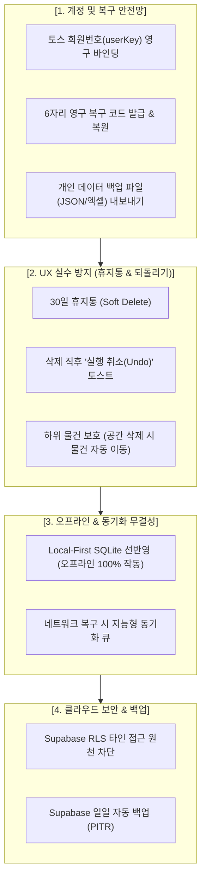

# 🛡️ '아 찾았다 · 내 물건 찾기' 유저 데이터 안전성 보장 방안

> 본 문서는 기기 변경, 앱 캐시 초기화, 오프라인 환경, 유저의 실수 삭제 등 **어떠한 상황에서도 유저의 소중한 물건 데이터가 유실되지 않도록 보장하기 위한 기술적·UX적 5대 안전장치**를 정의합니다.

---

## 📌 1. 데이터 위협 요인 분석 및 해결 매트릭스

| 위협 시나리오 | 발생 원인 | 데이터 유실 위험도 | 해결 방안 |
| :--- | :--- | :---: | :--- |
| **기기 변경 / 분실** | 새 스마트폰으로 교체하거나 공장초기화 | **매우 높음** | **6자리 영구 복구 코드** 및 **토스 계정(userKey) 연동** |
| **앱 캐시 / 세션 삭제** | 브라우저 캐시 삭제, 앱 재설치 | **높음** | 익명 세션 재바인딩 + 복구 코드 1초 복원 |
| **실수로 인한 삭제** | 공간/수납처/물건을 실수로 잘못 삭제 | **중간** | **휴지통(Soft Delete) 30일 보관** 및 즉시 되돌리기 |
| **네트워크 단절 / 오프라인** | 지하 창고나 와이파이 불통 지역에서 등록 | **중간** | **Local-First(SQLite 선기록)** + 백그라운드 자동 재시도 큐 |
| **가족 동시 수정 충돌** | 두 사용자가 동시에 같은 물건 이동/수정 | **낮음** | **타임스탬프 기반 낙관적 락(OCC)** 및 안전 병합 |
| **클라우드 서버 장애** | Supabase 일시적 장애 | **매우 낮음** | **Supabase 일일 자동 백업** + 로컬 DB 영구 보존 |

---

## 🛡️ 2. 유저 데이터 안전 보장을 위한 5대 핵심 방안

---

### 방안 1. 기기 변경·캐시 초기화 대비 영구 복구 체계 구축 (계정 레벨)

가장 빈번하고 치명적인 데이터 유실 시나리오는 **"스마트폰을 바꿨을 때"**와 **"토스 앱 캐시를 정리했을 때"**입니다. 이를 3단계 안전망으로 해결합니다:

1. **6자리 영구 복구 코드 (단기 - v1.1.0 구현)**
   - 모든 유저에게 고유한 `6자리 영구 복구 코드`(예: `MY-8291`)를 발급합니다.
   - 유저가 폰을 바꾸거나 앱을 재설치했을 때, 첫 화면에서 이 코드만 입력하면 **기존의 모든 공간, 수납처, 물건, 사진이 1초 만에 그대로 복원**됩니다.
2. **토스 회원번호(`userKey`) 영구 연동 (중장기 - 토스 로그인 연동)**
   - 토스 SDK의 `userKey`를 Supabase 보관소와 1:1로 결합합니다.
   - 유저는 별도로 코드를 외울 필요도 없이, **새 폰에서 토스 앱으로 접속하기만 하면 내 보관소가 100% 자동 유지**됩니다.
3. **내 데이터 백업 파일(JSON/엑셀) 내보내기**
   - 설정 메뉴에서 유저가 원할 때 언제든 `내 물건 전체 목록 백업 파일`을 다운로드하거나 카카오톡/메모장으로 내보낼 수 있도록 지원합니다.

---

### 방안 2. '휴지통(Soft Delete)' 및 실행 취소(Undo) 도입 (실수 방지)

유저가 수십 개의 물건이 들어있는 서랍장이나 방을 실수로 삭제 버튼을 누르는 사고를 원천 차단합니다.

1. **30일 휴지통 시스템 (Soft Delete)**
   - 삭제 버튼을 눌러도 데이터베이스에서 즉시 삭제(Hard Delete)하지 않고 `deleted_at` 필드만 기록합니다.
   - 설정 내 **[휴지통]** 메뉴에서 30일 이내 언제든 버튼 한 번으로 원상 복구할 수 있습니다.
2. **삭제 직후 5초간 '실행 취소(Undo)' 토스트**
   - 물건이나 공간을 삭제했을 때 화면 하단에 `[방금 삭제한 항목을 취소하시겠습니까? (5초)]` 토스트를 띄워 즉시 되돌릴 수 있는 기회를 제공합니다.
3. **연쇄 삭제 안전장치**
   - 물건이 들어있는 공간/수납처를 삭제하려 할 때:
     - `"이 공간에 물건 12개가 들어있습니다. 물건들을 [미분류 보관함]으로 이동하고 공간만 삭제할까요?"` 선택지를 제공하여 물건이 함께 증발하는 것을 방지합니다.

---

### 방안 3. 'Local-First' 기반 오프라인 무손실 동기화 (네트워크 무결성)

지하 주차장, 베란다 구석, 캠핑장 등 인터넷 신호가 약하거나 끊긴 곳에서도 데이터가 안전하게 저장되어야 합니다.

1. **로컬 SQLite 선기록 원칙**
   - 유저가 [등록] 또는 [수정]을 누르면 서버 응답을 기다리지 않고 **기기 내부 SQLite DB에 즉시 0.01초 만에 안전 기록**됩니다.
   - 앱이 꺼지거나 통신이 두절되어도 이미 로컬 저장소에 영구 보존되므로 데이터가 날아가지 않습니다.
2. **지능형 재시도 큐 (Sync Queue)**
   - 오프라인 상태에서 작성된 데이터는 `동기화 대기 큐`에 쌓여 있다가, 와이파이나 LTE가 연결되는 즉시 백그라운드에서 Supabase로 자동 업로드됩니다.
3. **충돌 없는 안전 병합 (Timestamp OCC)**
   - 가족과 함께 쓸 때 동시에 같은 물건을 수정하더라도, 최신 타임스탬프(`updated_at`)를 기준으로 정밀 비교하여 데이터 덮어쓰기 손실을 방지합니다.

---

### 방안 4. 가족 데이터 병합 시 데이터 보존 (합류 시 무손실)

가족 구성원이 각자 등록하던 물건을 하나의 보관소로 합칠 때 발생하는 데이터 유실을 방지합니다.

1. **'내 물건 가지고 합류하기' 기본 옵션**
   - 초대 코드를 입력하여 가족 보관소로 들어갈 때, 기존에 내가 등록해 둔 물건들을 가족 보관소로 그대로 이전(Merge)시켜 단 하나의 물건도 버려지지 않도록 보장합니다.
2. **이름 중복 자동 격리**
   - 양쪽에 동일한 이름의 공간(예: '안방 옷장')이 있더라도 데이터를 덮어쓰지 않고, 고유 식별자(UUID)로 안전하게 격리하거나 유저 확인 후 스마트 통합합니다.

---

### 방안 5. 클라우드 인프라 보안 및 백업 (서버 레벨)

1. **Supabase RLS(Row Level Security) 철저 적용**
   - 타인이 임의로 다른 사람의 보관소 ID를 호출하더라도 본인 가족 보관소 외의 데이터는 절대 조회/수정할 수 없도록 DB 레벨에서 원천 차단합니다.
2. **정기 일일 스냅샷 백업 (Disaster Recovery)**
   - Supabase 데이터베이스는 매일 자동으로 전체 스냅샷이 생성되어, 예기치 못한 인프라 장애 시에도 특정 시점으로 100% 롤백 복구가 가능합니다.
3. **이미지 용량 최적화 및 영구 보존**
   - 유저가 업로드한 물건 사진은 WebP 포맷으로 압축 저장되어 안정적인 CDN을 통해 영구 보존됩니다.

---

## 📋 3. 단계별 적용 일정

| 단계 | 적용 방안 | 적용 시점 |
| :---: | :--- | :---: |
| **1단계 (즉시/v1.1.0)** | • 6자리 영구 복구 코드 발급 & 기기 변경 복원 • 가족 합류 시 데이터 무손실 합치기(Merge) • 삭제 시 '실행 취소(Undo)' 토스트 | 차기 버전 (`v1.1.0`) |
| **2단계 (v1.2.0)** | • 30일 휴지통(Soft Delete) 시스템 • 연쇄 삭제 방지 (미분류 보관함으로 이동) • 데이터 내보내기/백업 (JSON/엑셀) | v1.2.0 |
| **3단계 (고도화)** | • 토스 회원번호(`userKey`) 기반 100% 무인 자동 복구 연동 | v1.3.0 이후 |
