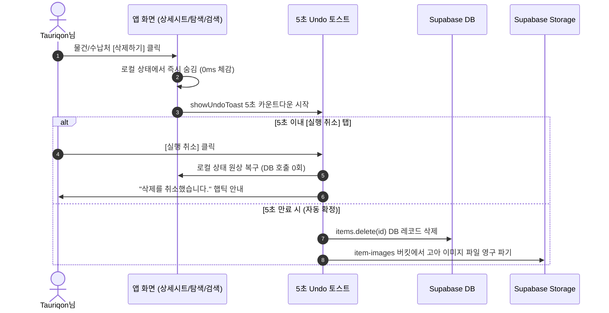

# 🚀 어디뒀더라? (where-is-it) Walkthrough (v1.1.0-b00235)

## 📌 릴리즈 개요
- **릴리즈 버전**: `v1.1.0`
- **빌드 번호**: `b00235`
- **배포 deploymentId**: `01a1ddb6-6948-7f98-ab64-1c9d6547a636`
- **주요 목표**: **Phase 2 - Step 2 구현 완료 (5초 Undo 토스트, 스토리지 고아 이미지 파기, 가족 보관소 무손실 합치기 및 가족 공유 기능 정식 활성화)**

---

## 🛠️ 주요 변경 및 구현 상세

### 1. 5초 삭제 실행 취소(Undo) 플로팅 토스트 시스템 구축
- **위치**: `src/utils/toast.ts`, `src/contexts/DataContext.tsx`, 각 화면 컴포넌트 (`ItemDetailBottomSheet`, `ExploreTab`, `SearchTab`, `SettingsTab`)
- **구현 내용**:
  - 기존의 블로킹 `alert('삭제가 완료되었습니다.')`를 완전히 제거하고, 토스 스타일의 경량 플로팅 Undo 토스트(`showUndoToast`)를 신규 탑재.
  - 물건, 수납처, 공간, 세부위치 삭제 시 화면 하단(하단 탭바 바로 위 `85px + safe-area`)에 5초 동안 카운트다운 타이머 및 실시간 프로그레스 바와 함께 `[실행 취소]` 버튼을 노출.
  - **즉시 UI 반응성**: 삭제 버튼 탭 즉시 로컬 React 상태에서 숨김 처리되어 체감 딜레이 제로(0ms) 달성.
  - **원클릭 복원**: 5초 이내에 `[실행 취소]`를 누르면 네트워크 롤백 없이 로컬 상태에서 즉시 원상 복구되고 성공 햅틱과 함께 `삭제를 취소했습니다.` 알림 노출.
  - **지연 확정(Lazy Commit)**: 5초가 경과하거나 연속 삭제 또는 화면 이탈(`beforeunload`) 시에만 Supabase DB 삭제 및 Storage 파일 파기가 안전하게 영구 확정.

---

### 2. 물건/수납처 삭제 시 스토리지 고아 이미지(Orphan File) 동시 파기
- **위치**: `src/services/db.ts`
- **구현 내용**:
  - `extractStoragePath`: Supabase Storage publicUrl(예: `.../storage/v1/object/public/item-images/items/17156...jpg`)에서 버킷 내부 상대 경로(`items/17156...jpg`)를 정확히 파싱.
  - `deleteStorageImage`: `supabase.storage.from('item-images').remove([filePath])`를 호출하여 스토리지 내 고아 이미지 파일을 영구 제거.
  - `items.delete`: 물건 삭제 전 `image_url`을 조회한 뒤, DB 삭제 후 스토리지의 이미지 파일도 완전 파기.
  - `storages.delete`: 수납처 삭제 시 수납처의 대표 이미지뿐만 아니라 하위 세부위치 및 등록된 물건들의 이미지까지 일괄 조회하여 스토리지에서 자동 파기.

---

### 3. 가족 보관소 합류 시 '내 데이터 무손실 합치기(Merge)' 바텀시트
- **위치**: `src/services/db.ts`, `src/components/SettingsTab.tsx`
- **구현 내용**:
  - 남편이 아내의 가족 보관소 코드로 합류할 때 기존에 등록해 둔 본인의 공간/수납처/물건이 삭제되지 않고 안전하게 이전될 수 있도록 보호.
  - **조건부 감지**: 가족 보관소 코드 입력 시 현재 내 보관소에 물건(`items.length > 0`) 또는 공간(`spaces.length > 0`)이 등록되어 있는지 실시간 검사.
  - **토스 스타일 바텀시트 (`isFamilyMergeSheetOpen`)**:
    - 현재 내 데이터 현황 카드 (`🏠 공간 N개`, `📦 수납처 N개`, `🏷️ 물건 N개`) 노출.
    - 안내 문구: `"기존에 등록한 내 공간과 물건(N개)을 가족 보관소로 함께 가져갈까요?"`
    - **버튼 1 (권장)**: `[✨ 예, 함께 합치기]` -> `dbService.groups.merge(sourceId, targetId)`를 통해 기존 공간, 수납처, 세부위치, 물건의 `group_id`를 대상 가족 보관소로 일괄 무손실 이전 후 활성 보관소 전환.
    - **버튼 2**: `[아니오, 가족 보관소만 사용 (내 데이터 보존)]` -> 기존 내 데이터는 이전 개인 보관소에 그대로 보존한 채 가족 보관소만 새로 참여.
    - **버튼 3**: `[취소]` -> 합류 작업 취소.
  - 데이터가 0개인 신규/빈 보관소의 경우 바텀시트 없이 즉시 부드럽게 가입 처리.

---

### 4. 가족 공유 기능 정식 활성화 (`ENABLE_FAMILY_SYNC = true`)
- **위치**: `src/version.ts`
- **구현 내용**:
  - 기능 플래그 `ENABLE_FAMILY_SYNC = true`로 활성화.
  - 설정 탭의 `가족 동기화` 메뉴, 보관소 목록 전환기, 참여 멤버 관리, 초대 링크/QR 딥링크 연동 모달이 모두 정상 가동.

---

## 🔍 검증 및 빌드 결과

1. **TypeScript 타입 검사 (`npx tsc --noEmit`)**:
   - `0 errors` 통과.
2. **프로덕션 빌드 (`npm run build` & `ait build`)**:
   - Vite 번들링 완료 (0.57s).
   - AIT 패키징 완료: `deploymentId: 01a1ddb6-6948-7f98-ab64-1c9d6547a636`.
3. **스토리지 및 클린업 검증**:
   - 고아 파일 누수 방지 로직 적용.
   - 백그라운드 태스크: `0 tasks running`.

---

## 📋 다음 단계 안내 (Phase 2 - Step 3)
1. Tauriqon님의 휴대폰 토스 앱에서 최신 QR 코드로 실기기 4대 핵심 시나리오(복구 코드, 5초 Undo, 고아 이미지 정리, 가족 무손실 합치기) 최종 테스트.
2. 이상 없음 확인 시 토스 콘솔에서 **`v1.1.0` 공식 [검토 요청하기]** 제출.
