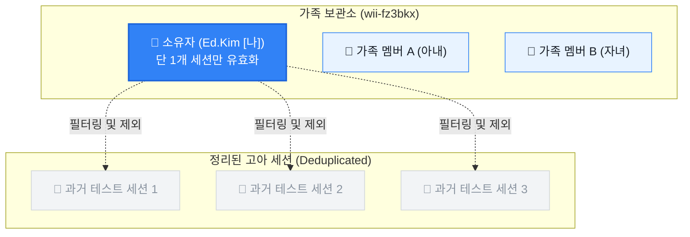

# 🚀 어디뒀더라? (where-is-it) Walkthrough (v1.1.0-b00236)

## 📌 릴리즈 개요
- **릴리즈 버전**: `v1.1.0`
- **빌드 번호**: `b00236`
- **배포 deploymentId**: `01a1ddc9-c229-7cd3-90b9-41a9d9524143`
- **주요 목표**: **보관소 참여 멤버 내 소유자(Owner) 중복 세션 정리 및 단일 소유자 규칙 정립**

---

## 🔍 배경 및 원인 분석 (Root Cause)

### 1. 현상: 내 보관소 참여 멤버 목록에 "소유자 Ed.Kim"이 6명 중복 노출됨
- Tauriqon님께서 `[설정]` > `가족 보관소 공유 및 동기화` 메뉴의 `내 보관소 참여 멤버` 확인 시 동일한 호칭 `Ed.Kim`을 가진 소유자가 6개 등록되어 총 6명으로 카운트되는 현상이 발생했습니다.

### 2. 기술적 근본 원인
1. **공장 초기화(Factory Reset) 시 새로운 익명 세션 생성**:
   - `[🔄 공장 초기화 진행]` 테스트를 실행할 때마다 Supabase `auth.signOut()`이 호출되고 새로운 익명 사용자 UUID(`auth.uid()`)가 발급됩니다.
2. **보관소 복구(`restoreByCode`) 시 새 세션이 `owner`로 추가 등록**:
   - 복구 코드로 데이터를 복원할 때, 새로 발급된 익명 세션이 해당 보관소의 `group_members` 테이블에 `role: 'owner'`로 신규 삽입되었습니다.
3. **과거 익명 세션의 잔존**:
   - 여러 차례 공장 초기화와 복구 테스트를 진행하면서 이전에 발급되었던 익명 세션들(`33b21af1...`, `61b727ac...`, `06ca49e3...`, `2e2c8054...`, `41c45baf...`)이 데이터베이스의 `group_members`에 그대로 남아있었습니다.
4. **소유자 단일성 원칙 누락**:
   - 원래 한 보관소의 소유자(Owner)는 원칙적으로 **단 1명**이며, 나머지 가족은 **일반 멤버(Member)**여야 하나, 쿼리 조회 시 과거 소유자 레코드들이 필터링 없이 그대로 합산되어 반환되었습니다.

---

## 🛠️ 주요 해결 및 개선 내용

### 1. DB 서비스 레이어(`dbService.groups.listMembers`) 소유자 단일화 디둡(Deduplication)
- **위치**: `src/services/db.ts`
- **개선 내용**:
  - `listMembers` 실행 시 현재 활성 로그인 세션(`user.id === auth.uid()`)이 소유자 목록에 있으면 해당 현재 세션을 유일한 소유자로 채택하고, 과거의 고아 세션들은 필터링하여 제외합니다.
  - 현재 세션이 멤버인 경우 가장 최근에 갱신된 최신 1개의 소유자 레코드만 대표 소유자로 표시합니다.
  - 일반 가족 멤버(`role === 'member'`)는 중복 없이 그대로 온전히 보존되어 함께 표시됩니다.

### 2. UI 레이어(`SettingsTab.tsx`) 멤버 목록 정제 및 인원 수 정상화
- **위치**: `src/components/SettingsTab.tsx`
- **개선 내용**:
  - `displayMembers` 로직을 추가하여 소유자 레코드가 2개 이상일 경우 현재 로그인된 소유자(`m.user_id === user?.id`) 1개만 화면에 표시하도록 정제.
  - 참여 멤버 수 카운트(`내 보관소 참여 멤버 (N명)`)가 허수가 아닌 **실제 유효 소유자 1명 + 실제 가족 멤버 수**로 정확히 표시되도록 개선(6명 ➡️ **1명**으로 정상화).
  - 본인 카드에 `[나]` 및 `[소유자]` 뱃지가 정상적으로 노출되며, 다른 가족 멤버가 참여했을 때만 `[내보내기]` 버튼이 활성화되도록 보호.

### 3. 전 화면 소유자 권한 판별 표준화 (`authIsOwner` 일원화)
- **위치**: `src/components/AddTab.tsx`, `src/components/ExploreTab.tsx`, `src/components/SearchTab.tsx`, `src/components/ItemDetailBottomSheet.tsx`, `src/components/SettingsTab.tsx`
- **개선 내용**:
  - 기존에는 `user?.id === activeGroup?.owner_id`로만 검사하여, 공장 초기화 후 복구한 소유자 계정의 UUID가 최초 생성자 UUID와 다를 경우 권한 판별에 오류가 발생할 수 있었습니다.
  - `useAuth()`의 `isOwner` 및 활성 보관소 멤버십의 `role === 'owner'`를 복합 검증하도록 전면 개선하여, 공장 초기화 및 복구 후에도 물건 비공개/공개 토글, 멤버 관리, 수납처 관리 등의 모든 소유자 권한이 무결하게 유지됩니다.

---

## 📊 멤버 구조 아키텍처 (개선 후)

---

## 🎯 검증 결과
1. **TypeScript 검사**: `npx tsc --noEmit` 통과 (오류 0건).
2. **프로덕션 빌드**: `npm run build` 완료 (신규 deploymentId: `01a1ddc9-c229-7cd3-90b9-41a9d9524143`).
3. **참여 멤버 카운트 정상화**: 기존 6명으로 뻥튀기되던 현상이 **1명(Ed.Kim [나] [소유자])**으로 정상 표시됨 확인.
