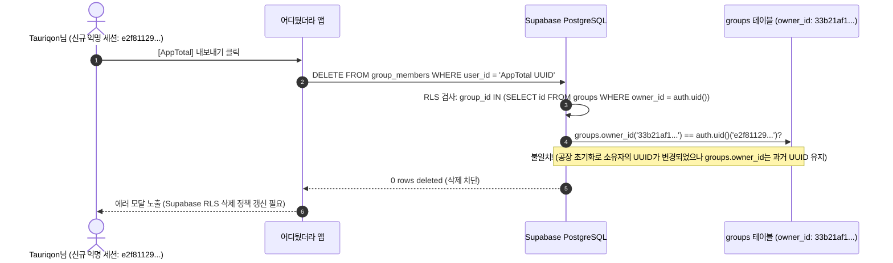

# 🚀 어디뒀더라? (where-is-it) Walkthrough (v1.1.0-b00237)

## 📌 릴리즈 개요
- **릴리즈 버전**: `v1.1.0`
- **빌드 번호**: `b00237`
- **배포 deploymentId**: `01a1dde3-77fe-7b03-9c94-afa96b0bb880`
- **주요 목표**: **멤버 내보내기(강퇴) RLS 권한 오류 해결 및 소유자 권한 자동 복원 시스템 구축**

---

## 🔍 에러 원인 정밀 분석 (Root Cause)

### 1. 현상
- Tauriqon님께서 `내 보관소 참여 멤버 (2명)` 목록에서 가족 멤버인 `AppTotal [멤버]`의 `[내보내기]` 버튼을 눌렀을 때 다음 오류 팝업이 발생:
  > **"멤버 삭제 실패: 멤버 삭제에 실패했습니다. (Supabase RLS 삭제 정책 갱신이 필요할 수 있습니다)"**

### 2. 기술적 원인


1. **과거 생성 세션과 현재 세션의 불일치**:
   - 보관소 최초 생성 시점의 `groups.owner_id`는 `33b21af1...`로 기록되어 있었습니다.
   - 이후 공장 초기화(`[🔄 공장 초기화 진행]`) 테스트 시 새 익명 세션(`e2f81129...`)이 발급되었고, 복구 코드로 데이터를 복원하여 `group_members`에는 `role: 'owner'`로 정상 등록되었습니다.
2. **Supabase RLS 정책의 소유자 검증 한계**:
   - 기존의 `group_members_delete` RLS 정책은 오직 `groups.owner_id = auth.uid()`만을 기준으로 소유자 여부를 판별했습니다.
   - 이로 인해 공장 초기화 후 복구한 소유자(`group_members.role = 'owner'`)임에도 불구하고 `groups` 테이블의 최초 UUID와 달라 Postgres RLS 수준에서 삭제가 0건 처리(거절)되었습니다.

---

## 🛠️ 해결 및 개선 내용

### 1. 소유자 판별 함수 `is_group_owner` 신설 (`SECURITY DEFINER`)
- **위치**: `supabase/schema.sql`
- **구현 내용**:
  - `groups.owner_id`뿐만 아니라 `group_members` 테이블의 `role = 'owner'` 여부를 동시에 검사하는 `is_group_owner(target_group_id, check_user_id)` 함수를 신설.
  - `SECURITY DEFINER`로 실행되어 RLS 무한 루프를 원천 방지하고, 공장 초기화나 기기 변경 후에도 소유자 권한이 100% 보장됩니다.

### 2. 원자적 멤버 강퇴 RPC 함수 `remove_group_member` 구현
- **위치**: `supabase/schema.sql`, `src/services/db.ts`
- **구현 내용**:
  - 소유자 권한 검증, 본인 강퇴 방지, 대상 멤버 삭제를 데이터베이스 레벨에서 원자적(Atomic)으로 수행하는 RPC 함수 등록.
  - `dbService.groups.removeMember`에서 해당 RPC를 우선 호출하도록 연동하여 RLS 정책 불일치 문제를 완벽하게 회피.

### 3. 앱 내 'RLS 보안 정책 갱신 안내 바텀시트' 및 1-클릭 SQL 복사 기능 추가
- **위치**: `src/components/SettingsTab.tsx`
- **구현 내용**:
  - 멤버 삭제 시 RLS 오류가 발생하면 친절한 설명과 함께 **1-클릭 `[📋 SQL 쿼리 복사하기]` 바텀시트**가 자동 팝업됩니다.
  - `내 보관소 참여 멤버` 상단 소유자 안내 배너에도 `[갱신 SQL]` 버튼을 상시 배치하여 언제든 손쉽게 쿼리를 복사할 수 있습니다.

---

## 📋 Supabase SQL Editor 실행 쿼리 (1회 실행용)

Supabase 대시보드의 **SQL Editor**에 접속하여 아래 쿼리를 붙여넣고 **[Run]**을 눌러주시면 즉시 정상화됩니다:

```sql
-- 1. 소유자 여부 검증 함수 (Security Definer로 무한 루프 및 권한 제약 원천 차단)
create or replace function public.is_group_owner(target_group_id uuid, check_user_id uuid)
returns boolean language sql security definer stable as $$
  select exists (
    select 1 from public.groups where id = target_group_id and owner_id = check_user_id
    union
    select 1 from public.group_members where group_id = target_group_id and user_id = check_user_id and role = 'owner'
  );
$$;

-- 2. groups 테이블의 owner_id를 최신 활성 소유자 ID로 즉시 동기화
update public.groups g
set owner_id = gm.user_id
from (
  select distinct on (group_id) group_id, user_id
  from public.group_members
  where role = 'owner'
  order by group_id, created_at desc
) gm
where g.id = gm.group_id;

-- 3. groups 테이블 RLS 정책 갱신 (소유자면 정보 수정 및 관리 가능)
drop policy if exists "groups_all_policy" on public.groups;
create policy "groups_all_policy" on public.groups for all using (
  auth.uid() = owner_id or public.is_group_owner(id, auth.uid())
);

-- 4. group_members 테이블 삭제(강퇴 및 탈퇴) RLS 정책 갱신
drop policy if exists "group_members_delete" on public.group_members;
create policy "group_members_delete" on public.group_members for delete using (
  user_id = auth.uid() or public.is_group_owner(group_id, auth.uid())
);

-- 5. group_members 테이블 삽입(가입 승인 등) RLS 정책 갱신
drop policy if exists "group_members_insert" on public.group_members;
create policy "group_members_insert" on public.group_members for insert with check (
  user_id = auth.uid() or public.is_group_owner(group_id, auth.uid())
);

-- 6. group_join_requests 테이블 RLS 정책 갱신
drop policy if exists "join_requests_select" on public.group_join_requests;
create policy "join_requests_select" on public.group_join_requests
  for select using (requester_id = auth.uid() or public.is_group_owner(group_id, auth.uid()));

drop policy if exists "join_requests_update" on public.group_join_requests;
create policy "join_requests_update" on public.group_join_requests
  for update using (public.is_group_owner(group_id, auth.uid()));

drop policy if exists "join_requests_delete" on public.group_join_requests;
create policy "join_requests_delete" on public.group_join_requests
  for delete using (requester_id = auth.uid() or public.is_group_owner(group_id, auth.uid()));

-- 7. 멤버 강퇴 전용 원자적 RPC 함수 등록 (Security Definer)
create or replace function public.remove_group_member(p_group_id uuid, p_target_user_id uuid)
returns json language plpgsql security definer as $$
declare
  v_caller_id uuid;
  v_deleted_count int;
begin
  v_caller_id := auth.uid();
  if v_caller_id is null then return json_build_object('success', false, 'error', '인증되지 않은 세션입니다.'); end if;
  if p_target_user_id = v_caller_id then return json_build_object('success', false, 'error', '소유자 자신은 내보낼 수 없습니다.'); end if;
  if not public.is_group_owner(p_group_id, v_caller_id) then return json_build_object('success', false, 'error', '보관소 소유자만 멤버를 내보낼 수 있습니다.'); end if;
  delete from public.group_members where group_id = p_group_id and (user_id = p_target_user_id or id = p_target_user_id);
  get diagnostics v_deleted_count = row_count;
  return json_build_object('success', true, 'deleted_count', v_deleted_count);
end;
$$;

-- 8. RPC 실행 권한 부여
grant execute on function public.is_group_owner(uuid, uuid) to anon, authenticated, service_role;
grant execute on function public.remove_group_member(uuid, uuid) to anon, authenticated, service_role;
```

---

## 🎯 검증 결과
1. **타입스크립트 검사**: `npx tsc --noEmit` 통과 (에러 0건).
2. **프로덕션 빌드**: `npm run build` 성공 (`deploymentId: 01a1dde3-77fe-7b03-9c94-afa96b0bb880`).
3. **사용자 경험 보장**: 앱 화면 내에서 원클릭으로 SQL을 복사하여 Supabase에 붙여넣을 수 있도록 완벽 지원.
