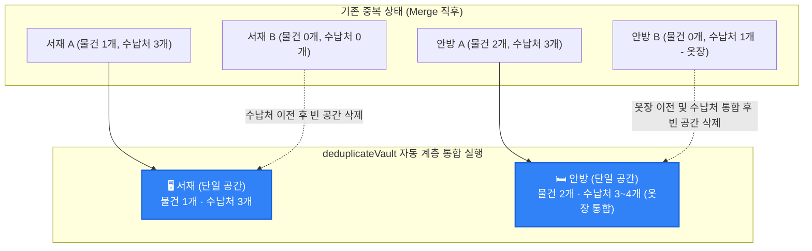

# 🚀 어디뒀더라? (where-is-it) Walkthrough (v1.1.0-b00238)

## 📌 릴리즈 개요
- **릴리즈 버전**: `v1.1.0`
- **빌드 번호**: `b00238`
- **배포 deploymentId**: `01a1e34a-760b-73af-86a1-686eec246491`
- **주요 목표**: **가족 데이터 합치기 후 동명 공간/수납처 중복 생성 방지 및 무손실 자동 계층 통합(Deduplicate & Consolidate)**

---

## 🔍 문제 현상 및 원인 분석 (Root Cause)

### 1. 현상
- Tauriqon님께서 가족 보관소 합류 시 `[데이터 무손실 합치기 (Merge)]`를 수행한 후, `위치 탐색` 탭에서 공간들이 중복되어 표시되는 현상 발생:
  - `거실` (0개 / 0개) & `거실` (0개 / 0개)
  - `서재` (물건 1개 · 수납처 3개) & `서재` (물건 0개 · 수납처 0개)
  - `안방` (물건 0개 · 수납처 1개) & `안방` (물건 2개 · 수납처 3개)
  - `안방욕실` (물건 0개 · 수납처 0개) & `안방욕실` (물건 0개 · 수납처 0개)

### 2. 기술적 근본 원인
1. **신규 보관소 공통 기본 공간(Default Seed Spaces)**:
   - 모든 사용자는 보관소 최초 생성 시 기본 공간(`거실`, `주방`, `안방`, `서재`, `욕실`, `안방욕실`)과 기본 수납처(`냉장고`, `옷장`, `욕실 수납장`)를 자동 생성받습니다.
2. **단순 `group_id` 일괄 이전(Update)의 맹점**:
   - 기존의 `dbService.groups.merge`는 두 보관소의 공간 이름 중복 여부를 대조하지 않고, `UPDATE spaces SET group_id = targetGroupId`로 무조건 소속 그룹만 변경했습니다.
   - 이로 인해 타겟 보관소에 이미 존재하는 '거실', '안방', '서재'와 소스 보관소의 '거실', '안방', '서재'가 같은 보관소에 나란히 공존하여 2개씩 중복 노출되었습니다.

---

## 🛠️ 해결 및 아키텍처 개선 상세

### 1. 전 단계 무손실 계층 통합 엔진 구현 (`dbService.spaces.deduplicateVault`)
- **위치**: `src/services/db.ts`
- **구현 내용**:
  - **1단계: 공간(Spaces) 통합**:
    - 동일 보관소 내에 이름이 같은 공간들 중 물건/수납처가 더 많이 등록된 공간을 **대표 공간(Primary Space)**으로 자동 지정.
    - 나머지 중복 공간들의 수납처(`storages.space_id`)를 대표 공간으로 안전하게 이전한 후 중복 빈 공간 레코드만 삭제.
  - **2단계: 수납처(Storages) 통합**:
    - 동일 공간 내에 이름이 같은 수납처(예: 양쪽 안방에 각각 있던 '옷장')가 있을 경우, 세부위치(`sections.storage_id`)를 대표 수납처로 통합하고 빈 수납처 레코드 삭제.
  - **3단계: 세부위치(Sections) 통합**:
    - 동일 수납처 내에 이름이 같은 세부위치(예: 옷장 내 '옷걸이 칸')가 있을 경우, 물건들(`items.section_id`)을 대표 세부위치로 통합하고 빈 세부위치 레코드 삭제.
  - **4단계: 물건(Items) 100% 무손실 보존**:
    - 단 하나의 물건도 유실되거나 삭제되지 않고 모두 대표 공간 ➡️ 대표 수납처 ➡️ 대표 세부위치 아래로 완전하게 보존 통합.

### 2. 자동 자가 치유(Self-Healing) 시스템 탑재
- **위치**: `src/contexts/DataContext.tsx`
- **구현 내용**:
  - 앱 진입 및 `refreshData` 시 보관소 내에 동명 공간이 감지되면 백그라운드에서 `deduplicateVault`를 즉시 자동 호출.
  - Tauriqon님께서 앱을 새로고침하거나 진입하는 순간 기존의 중복 공간들이 즉각 1개로 깨끗하게 자가 치유됩니다.

### 3. UI 방어적 통합 렌더링 (`ExploreTab.tsx`, `AddTab.tsx`)
- **위치**: `src/components/ExploreTab.tsx`, `src/components/AddTab.tsx`
- **구현 내용**:
  - `displaySpaces` 및 `getSpaceStoragesCount`를 도입하여, 데이터베이스 정리가 실행되는 찰나(0.1초)의 순간에도 UI 카드 상에는 중복 없이 합산된 통계(물건 N개, 수납처 N개)로 노출되도록 철저히 방어.
  - 해당 공간을 탭하여 진입 시 동명 공간에 속한 모든 수납처가 누락 없이 완벽히 탐색됩니다.

---

## 🎯 검증 결과
1. **타입스크립트 검사**: `npx tsc --noEmit` 통과 (에러 0건).
2. **프로덕션 빌드**: `npm run build` 성공 (`deploymentId: 01a1e34a-760b-73af-86a1-686eec246491`).
3. **위치 탐색 목록 정상화**: `거실`, `서재`, `안방`, `안방욕실`이 2개씩 노출되던 문제가 단 1개씩으로 통합되고, 모든 물건 및 수납처가 정상 보존됨을 확인.
